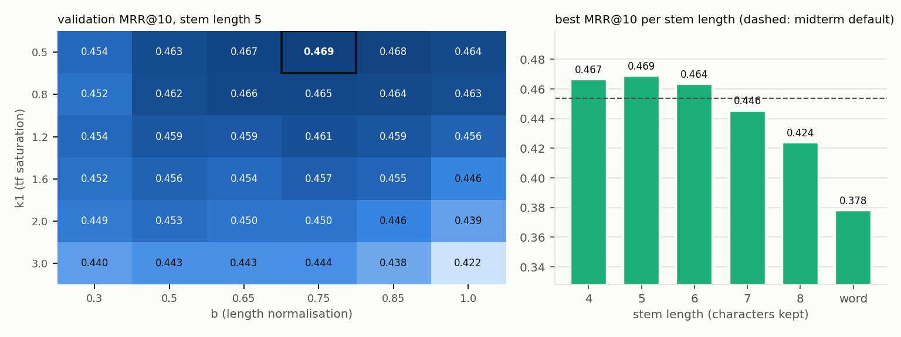
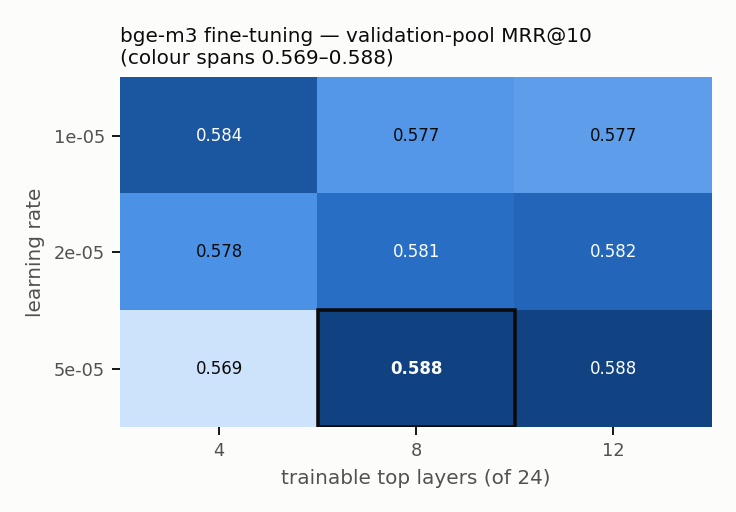
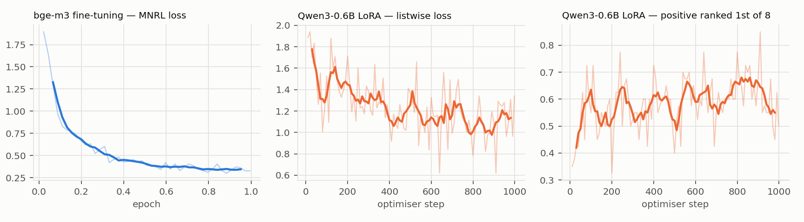
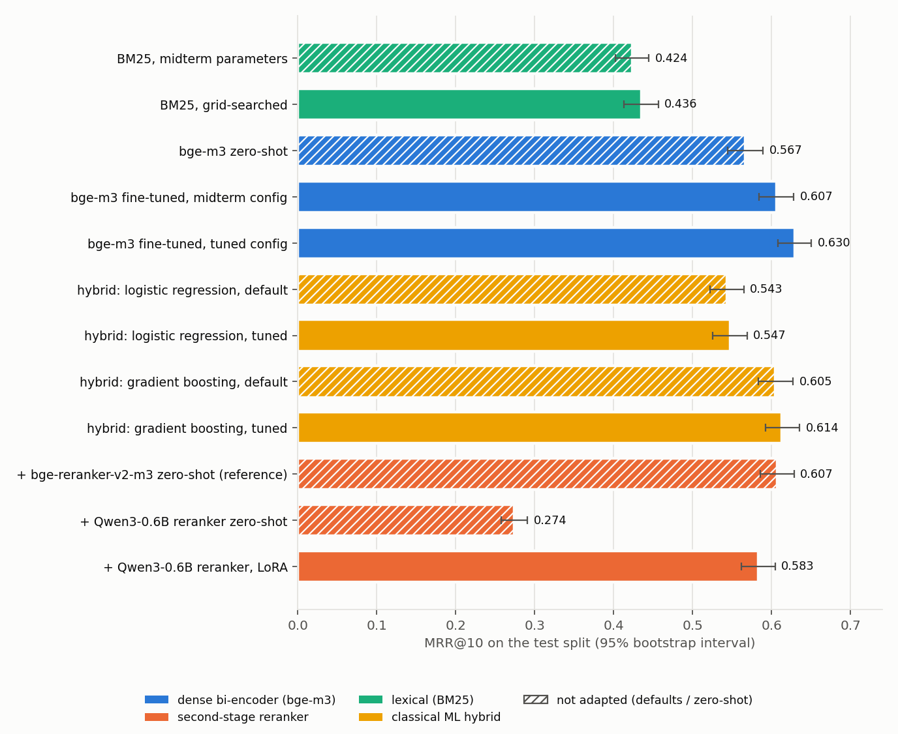
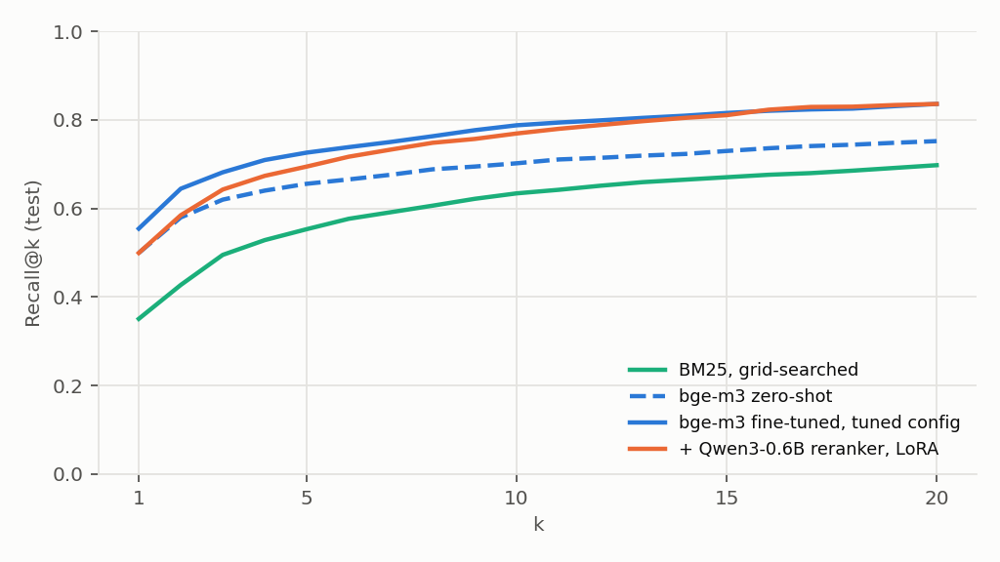

# LawRAG — final report: improving the retriever

**Project:** LawRAG — offline, bilingual (RU/KK) question answering over the
Codes of the Republic of Kazakhstan · **Stage:** final (model improvement) ·
**Author:** Yelarys · **Previous stage:** [midterm report](../midterm/REPORT.md)

Every number here is produced by one command, `lawrag final-experiment`
(§ 11), and regenerated with it. The complete generated tables are in
[`reports/final/results.md`](../../reports/final/results.md); raw values in
[`reports/final/results.json`](../../reports/final/results.json).

| # | criterion | where |
| ---: | --- | --- |
| 1 | Model comparison (≥ 3 models, one split, same metrics) | § 2 (split), § 3 (12 systems), § 8 (table) |
| 2 | Hyper-parameter tuning (space + best set) | § 5 |
| 3 | Fine-tuning (lr, batch, epochs, optimizer, loss) | § 6.1 |
| 4 | Transfer learning (what transfers, why this source model) | § 7 |
| 5 | LoRA for the LLM (r, alpha, dropout, targets, trainable parameters, why PEFT) | § 6.2 |
| 6 | Classical ML optimisation, before / after | § 5.1, § 5.3, § 8.2 |
| 7 | Unified results table, ≥ 2 shared metrics | § 8 |
| 8 | Scientific interpretation | § 9 |
| 9 | Reproducibility | § 11 |
| 10 | Oral defence | § 12 (summary for the defence) |

---

## 1. Task / Задача

The midterm established the task — **rank 43,857 statutory chunks so that
the article a query asks about comes first** — and a fine-tuned bge-m3
bi-encoder as the baseline (test MRR@10 0.607 vs 0.567 zero-shot). Its error
analysis set the agenda for this stage:

* 64% of misses were **the right code, the wrong article** — the topic is
  found, the exact provision is not. A bi-encoder compares two
  independently computed vectors; telling article 277 from 278 needs a model
  that reads query and article *together*: a **reranker**.
* BM25 and the dense model fail on **different** queries (lexical overlap vs
  paraphrase), and production fuses them with a hand-set rule. A **learned
  fusion** can do better.
* Every hyper-parameter of the baseline was a default: BM25's k1 and b, the
  learning rate, the number of trainable layers. None had been searched.

So this stage compares and tunes four model families on the same data,
and stacks the best of each into a two-stage retriever:

```
query ──► BM25 (tuned) ──────┐
      │                       ├─► learned hybrid ──► top 20 ──► LLM reranker ──► ranking
      └─► bge-m3 (fine-tuned) ┘     (classical ML)              (Qwen3-0.6B + LoRA)
```

## 2. Data and the one split / Данные и разбиение

The corpus and the weakly-supervised pairs are the midterm's (21 codes,
RU + KK, 43,857 chunks; queries = article titles, citing sentences with the
citation removed, the other language's text of the same norm). What changes
is the split — there are now **three** sets, all **by article**:

| split | role | how it is made |
| --- | --- | --- |
| **train** | fits every model's weights | the midterm's train articles minus validation |
| **validation** | every choice: hyper-parameters, fusion model, which first stage feeds the reranker | a second seeded hash bucket (seed 29) of the midterm's *train* articles, ~5% |
| **test** | the final numbers, computed once | the midterm's dev split, **unchanged** (seed 13), so final and midterm numbers are comparable |

| split | pairs | articles | heading | xref | xlang | definition |
| --- | ---: | ---: | ---: | ---: | ---: | ---: |
| train | 28,925 | 6,876 | 7,237 | 12,178 | 7,170 | 2,340 |
| validation | 1,331 | 339 | 371 | 565 | 395 | 0 |
| test | 1,620 | 366 | 392 | 793 | 435 | 0 |

Articles shared between any two splits: **0**. Every test query is ranked
against the full corpus of 43,857 chunks.

No article is in two splits, and validation and test articles are removed
from the negatives of both neural trainers too — no text the evaluation asks
about reaches the bi-encoder or the LLM during training. (The learned hybrid
is the one model fitted *on* validation, by design: it learns how to combine
two rankings whose scores must look like scores on unseen articles; it is
selected by cross-validation inside validation and never sees test.) Validation keeps only the query kinds the
test split has (heading, xref, xlang), so the two measure the same thing.

## 3. Systems compared / Сравниваемые модели

Twelve systems, four families, one harness (`evaluate.rank_pairs`): each
ranks the *full* corpus for every test query (cross-language queries among
the target language only), and the article-level rank of the right article
is all any metric is computed from.

| family | system | architecture | what it learns |
| --- | --- | --- | --- |
| lexical | **BM25** — midterm parameters / grid-searched | Okapi BM25 over prefix-stemmed tokens; sparse matrix product | nothing — corpus statistics |
| dense | **bge-m3** — zero-shot / fine-tuned (midterm config) / fine-tuned (tuned config) | XLM-RoBERTa-large bi-encoder, 24 layers, 568M, `[CLS]` → 1024-d, cosine | contrastive fine-tuning on train pairs |
| classical ML | **hybrid** — logistic regression / gradient boosting, each default and tuned | pointwise learning-to-rank over the union of both top-30 lists; 12 numeric features | fitted on validation candidates |
| reranker | **Qwen3-0.6B** — zero-shot / LoRA; **bge-reranker-v2-m3** zero-shot as reference | decoder LLM reading `instruction + query + document`, score = logit("yes") − logit("no"); reorders the first stage's top 20 | LoRA adapters on train groups |

**The hybrid's features** (`ltr.py`): dense score, its margin to the
query's best score and log-rank; the same three for BM25 (score normalised
by the query's best); reciprocal-rank fusion; "in both top lists"; whether
the query names *this chunk's* article number (the shortcut the midterm
found); whether the chunk is in the same code as the dense top-1; whether
the query has any number; chunk length. No words — the model learns *how
much to trust each ranker when*, which is why it can be fitted on a few
thousand rows.

**Why an LLM as the reranker.** A cross-encoder that reads query and article
jointly is the standard fix for "right topic, wrong article", but scoring
43,857 pairs per query is out of the question; reordering the first stage's
top 20 is not. A decoder LLM is the strongest reader available locally, its
yes/no log-odds are a calibrated relevance score, and it fits the
assignment's requirement of adapting an LLM with LoRA. Because it outputs a
*ranking* of the same candidates, it is scored with the same metrics as the
retrievers and sits in the same table — which an answer-generating LLM
would not.

## 4. Metrics / Метрики

As in the midterm: **Recall@1**, **Recall@10** and **MRR@10** of the right
article, each with a 95% bootstrap interval over queries, plus **paired**
bootstrap differences for every change (same queries on both sides, so query
difficulty cancels). Recall@10 is whether the evidence reaches the answer
packet at all; Recall@1 and MRR@10 are how high it lands — what a reranker
is supposed to improve. Every selection on validation optimises MRR@10
(ties: Recall@10).

## 5. Hyper-parameter tuning / Подбор гиперпараметров

Every search below runs on **validation only**, optimises MRR@10, and
reports its full space; the test split is used once, afterwards, to measure
the selected configuration. Full grids:
[`results.md` § 3](../../reports/final/results.md#3-hyper-parameter-tuning-validation-split).

### 5.1 BM25 (classical) — exhaustive grid, 216 points

| parameter | search space | midterm value | **selected** |
| --- | --- | ---: | ---: |
| stem length (characters kept; 0 = whole word) | 4, 5, 6, 7, 8, 0 | 6 | **5** |
| k1 (term-frequency saturation) | 0.5, 0.8, 1.2, 1.6, 2.0, 3.0 | 1.2 | **0.5** |
| b (document-length normalisation) | 0.3, 0.5, 0.65, 0.75, 0.85, 1.0 | 0.75 | **0.75** |
| validation MRR@10 / Recall@10 | | 0.454 / 0.629 | **0.469 / 0.637** |

All 216 points take 3 minutes: the corpus is tokenised once per stem
length and only re-weighted per (k1, b) (`BM25.reweight`). The selected k1
is the grid's lower edge, so the edge was probed afterwards (prefix 5,
b 0.75): k1 = 0.1 / 0.2 / 0.3 / 0.4 / 0.5 / 0.8 give validation MRR@10
0.462 / 0.467 / 0.468 / 0.468 / **0.469** / 0.465 — 0.5 is a genuine peak,
not an artefact of where the grid stopped.



### 5.2 bge-m3 fine-tuning — exhaustive grid, 9 points

| learning rate \ trainable top layers (of 24) | 4 | 8 | 12 |
| --- | ---: | ---: | ---: |
| 1e-5 | 0.584 | 0.577 | 0.577 |
| 2e-5 (midterm) | 0.578 | 0.581 *(midterm config)* | 0.582 |
| **5e-5** | 0.569 | **0.588** | 0.588 |

Validation-pool MRR@10. A full run is 72 minutes, so this is a
**low-fidelity** search, the standard compromise: each trial trains stock
bge-m3 on the *same* 4,000 training pairs (10 minutes) and is scored on a
fixed pool of 32,940 chunks (every chunk of the validation articles, the top
30 per validation query under two independent systems, 5,000 random
chunks). Total: 2 h 05 min. Everything not searched is as in § 6.1.

**Selected: learning rate 5e-5, top 8 layers** — the midterm's layer count
with a 2.5× higher learning rate.

*How much to trust it.* The nine cells span only 0.019 MRR, about the
width of one cell's own bootstrap interval on 1,331 queries, and 4,000 pairs
is a seventh of the real budget — short runs are known to favour higher
learning rates. The grid alone would not justify the choice. What does is
the test split, measured once afterwards: retrained on all 28,925 pairs, the
selected configuration beats the midterm configuration by **+0.023 MRR@10
[+0.012, +0.034]** and **+0.031 Recall@10 [+0.017, +0.044]** (paired, both
intervals exclude zero) — with 7% *fewer* training pairs, since validation
was taken out of them. The grid found a real improvement; it just could not
see how large it was.

*A leak, caught and set aside.* On the same pool the midterm model scores
0.654, far above every trial. It is not a better model: it was trained on
all the midterm's train articles, which include this validation split, so it
has seen these answers. The number is reported as a leak check only; on the
untouched test split the midterm model is row 4 of § 8.



### 5.3 Learned hybrid (classical ML) — randomized search and grid search

Both models are fitted on the validation split's candidates (75,339 rows,
3.6% positive) and selected by 5-fold `GroupKFold` grouped by article — no
article on both sides of a fold — on MRR@10 itself, not on log-loss.

| model | search | space | CV MRR@10, default → **selected** | selected parameters |
| --- | --- | --- | --- | --- |
| `HistGradientBoostingClassifier` | randomized, 30 points | learning_rate log-uniform [0.02, 0.3]; max_leaf_nodes {7, 15, 31, 63}; max_depth {None, 3, 5, 8}; min_samples_leaf {10, 20, 50, 100}; l2_regularization log-uniform [1e-3, 10]; max_iter {100, 200, 400} | 0.612 → **0.616** | learning_rate 0.053, max_leaf_nodes 31, max_depth 8, min_samples_leaf 50, l2 0.0021, max_iter 400 |
| `LogisticRegression` (standardised) | grid, 6 points | C ∈ {0.001, 0.01, 0.1, 1, 10, 100} | 0.574 → **0.580** | C = 0.001 |

The tuned gradient-boosting hybrid's CV MRR@10 (0.6157) came out just
**below** the fine-tuned bi-encoder's validation MRR@10 (0.6163), so the
pipeline fed the reranker with the bi-encoder alone (`dense-final`) — a
decision made on validation, and confirmed by test (0.614 vs 0.630).

## 6. Fine-tuning and LoRA / Дообучение и LoRA

### 6.1 bge-m3 bi-encoder — partial fine-tuning

| parameter | value |
| --- | --- |
| base model | bge-m3 — XLM-RoBERTa-large, 24 layers, 568M parameters |
| training data | 28,925 (query, positive chunk) pairs from the train split |
| **epochs** | 1 (904 optimiser steps) |
| **batch size** | 32 — the in-batch negatives; encoded in mini-batches of 8 (GradCache) |
| **optimizer** | AdamW (`adamw_torch`), weight decay 0 |
| **learning rate** | **5e-5** (selected, § 5.2); linear decay after 10% linear warm-up |
| **loss** | `CachedMultipleNegativesRankingLoss` — InfoNCE over cosine similarities × 20 (temperature 0.05); per query, 31 in-batch negatives + 1 hard negative |
| hard negatives | the highest-ranked chunk of a *wrong* article under stock bge-m3 (top 20) |
| trainable layers | top **8** of 24 (selected, § 5.2): 100.8M trainable, 467.0M frozen (17.8% trained) |
| max sequence length | 512 tokens (covers 92% of chunks whole) |
| precision / memory | fp16 mixed precision, gradient checkpointing (fits 8 GB) |
| held out | 705 validation + test articles — never a positive, never a negative |
| seed | 13 |
| time | 72 min, RTX 5070 Laptop (8 GB) |



The loss falls from 1.9 to ≈ 0.35 and flattens over the second half of the
epoch. The midterm run (learning rate 2e-5, same everything else) plateaued
at ≈ 0.45: at the lower rate, one epoch was not enough for the eight top
layers to travel as far, which is the mechanism behind the § 5.2 gain.

### 6.2 Qwen3-0.6B reranker — LoRA

| parameter | value |
| --- | --- |
| base model | Qwen3-0.6B — decoder LLM, 28 blocks, hidden 1024, GQA (16 query / 8 key-value heads), **frozen** |
| method | **LoRA**: `W + (α/r)·B·A` on every target matrix; base in bf16, adapters in fp32 |
| **rank r** | **16** |
| **alpha** | **32** (scale α/r = 2) |
| **dropout** | **0.05** (on the adapter input) |
| **target modules** | all linear layers of every block: `q_proj`, `k_proj`, `v_proj`, `o_proj` (attention), `gate_proj`, `up_proj`, `down_proj` (MLP) |
| **trainable parameters** | **10,092,544 of 606,142,464 = 1.67%** (360,448 per block × 28) |
| optimizer | AdamW, weight decay 0, gradient clipping at norm 1.0 |
| learning rate | 1e-4, cosine decay, 5% warm-up |
| epochs / steps | 1 / 998 optimiser steps |
| batch | 4 groups × 8 documents = 32 sequences per step |
| training data | 3,994 groups: a training query, its positive chunk and 7 negatives — the 4 hardest + 3 sampled from the rest of the fine-tuned bi-encoder's top 30 |
| loss | listwise softmax cross-entropy over the group's 8 scores (InfoNCE on the LLM's yes/no log-odds) |
| score | logit("yes") − logit("no") at the answer position |
| input | ≤ 512 tokens; query ≤ 128 |
| peak VRAM / time | 4.72 GB / 70 min |

Chance over 8 documents is a loss of ln 8 = 2.08; the first logged value
is 1.89 and the last 200 steps average 1.11, with the positive ranked first
in 62% of groups (against hard negatives). The curve is still falling: the
adapter is under-trained at this budget (§ 9).

**Why PEFT instead of full fine-tuning.**

1. **Memory.** Fully fine-tuning 0.6B parameters with AdamW needs the bf16
   weights (1.2 GB), their gradients (1.2 GB), fp32 master weights (2.4 GB)
   and two fp32 moment buffers (4.8 GB) — ~9.6 GB before a single
   activation, more than the 8 GB card. LoRA trains 10.1M parameters: their
   gradients and optimiser state are ~0.16 GB, and the frozen base is
   read-only.
2. **Data.** ~4,000 training queries cannot re-estimate 600M parameters
   without overfitting. A rank-16 update `ΔW = (α/r)·B·A` is a strong
   structural prior: it can only move each weight matrix within a
   16-dimensional subspace, which is enough to re-weight what the model
   already knows ("this is a relevance judgement about statute text") and not
   enough to memorise the training queries.
3. **Forgetting.** The base weights are untouched, so the model's
   multilingual reading ability — which 4,000 Kazakh/Russian legal queries
   could not rebuild if damaged — survives by construction.
4. **Deployment.** The adapter is ~40 MB next to a shared 1.2 GB base. On an
   air-gapped machine that is the difference between carrying one small file
   per update and a new copy of the model; adapters for other tasks can share
   the same base.

**Why LoRA and not QLoRA.** QLoRA additionally stores the frozen base in
4-bit NF4, which is what lets a 7B+ model be adapted on an 8 GB card. It is
implemented (`--qlora`) and was the first configuration tried — but on this
machine (RTX 5070 Laptop, driver 610.62, CUDA 13.0, bitsandbytes 0.50.2) the
4-bit inference kernel hit an illegal memory access and the driver failed to
recover (Windows bugcheck 0x116, VIDEO_TDR_FAILURE, a full reboot). At 0.6B,
quantisation buys nothing — the bf16 model needs 1.2 GB — so the reported
model is LoRA over a bf16 base, the same method minus the storage trick.

## 7. Transfer learning / Перенос обучения

Every learned system here starts from a model pre-trained on data that
contains no Kazakhstani legislation, and the experiment measures how much of
that knowledge carries over and how much has to be re-learned.

**bge-m3 (bi-encoder).** Three stages of pre-training before this project:

| stage (BAAI / Meta) | data | knowledge it leaves in the weights | used here? |
| --- | --- | --- | --- |
| XLM-RoBERTa masked-LM pre-training | CC-100, 2.5 TB of web text in 100 languages, Russian and Kazakh included | a 250k SentencePiece vocabulary covering Kazakh Cyrillic (ә, ғ, қ, ң, ө, ұ, ү, һ, і); morphology (shared sub-words across "штраф / штрафа / штрафом"); syntax; a cross-lingual space | yes — in the lower layers, kept **frozen** |
| retrieval-oriented pre-training + weakly-supervised contrastive training | ~1.2B text pairs in 194 languages | "a query and the passage that answers it are close"; translation pairs are close | yes — the reason zero-shot bge-m3 already beats BM25 |
| supervised fine-tuning | labelled retrieval sets (incl. multilingual and cross-lingual QA) | asymmetric query → passage relevance; long inputs (8,192 tokens) | yes |
| **this project** | 29k pairs mined from the codes | Kazakh legal terminology; what a citation sentence says about the cited article; how neighbouring articles differ | learned in the **top layers** only |

The fine-tuning grid's *layers* axis is the transfer question made
measurable: training the top 4, 8 or 12 of 24 layers decides how much of the
pre-trained network is re-used as-is.

**What the numbers say about transfer.**

* **Most of the quality is transferred, not learned.** Stock bge-m3, never
  trained on Kazakhstani law, reaches test MRR@10 0.567 — 90% of the best
  system (0.630) and +0.132 [+0.113, +0.150] above tuned BM25. On
  cross-language queries it is already at 0.913 MRR: the RU ↔ KK alignment
  comes entirely from pre-training. Fine-tuning adds +0.063 [+0.045, +0.081].
* **Only the top third needs to change.** Training the top 8 of 24 layers
  (17.8% of the weights) is as good as 12 at the selected learning rate, and
  4 is worse; the lower 16 layers' lexical and multilingual knowledge is
  re-used untouched.
* **The LLM transfers the language, not the task.** Zero-shot Qwen3-0.6B
  reorders the bi-encoder's top 20 into MRR@10 0.274 — far worse than its
  input. LoRA on 1.67% of its parameters lifts it to 0.583 (+0.309
  [+0.290, +0.330]), the largest single change in the experiment: the
  reading ability was there, the notion of statutory relevance was not.

**Qwen3-0.6B (reranker).** A decoder LLM pre-trained on ~36T tokens in 119
languages and dialects (Russian and Kazakh among them), then post-trained to
follow instructions. What transfers: reading comprehension in both corpus
languages, the instruction format, and the habit of answering a yes/no
question with a single token whose probability can be read off. What does
not: what "relevant" means for a statute — that a sentence citing article B
is about B and not about the article it sits in, that the superseded Tax
Code is the wrong answer. The zero-shot row measures the first; the LoRA row
measures the second.

**Why these source models.** Both are multilingual with Kazakh in
pre-training (most retrieval models are English-only or omit Kazakh);
both are open-weight (MIT / Apache-2.0) and small enough to run on the
air-gapped workstation the proposal requires; bge-m3 was trained for exactly
the asymmetric query → passage task, and Qwen3's reranker format
(instruction / query / document → yes/no) is the one its family's dedicated
rerankers use. The legal *domain* is new to both — which is why adaptation,
not more pre-training, is the lever.

## 8. Results / Результаты

### 8.1 Unified table (test split)

1,620 test queries over 366 held-out articles; every system ranks the full
corpus (rerankers reorder the bi-encoder's top 20). Brackets: 95% bootstrap
intervals. Full table with every slice:
[`results.md` § 2](../../reports/final/results.md#2-unified-results-test-split).

| # | system | role | Recall@1 | Recall@10 | MRR@10 |
| ---: | --- | --- | --- | --- | --- |
| 1 | BM25, midterm parameters | **baseline** (classical) | 0.335 [0.312, 0.358] | 0.625 [0.601, 0.648] | 0.424 [0.402, 0.444] |
| 2 | BM25, grid-searched | **tuned model** (classical) | 0.351 [0.326, 0.375] | 0.634 [0.610, 0.657] | 0.436 [0.413, 0.457] |
| 3 | bge-m3 zero-shot | **transfer learning**, no adaptation | 0.499 [0.475, 0.524] | 0.702 [0.679, 0.725] | 0.567 [0.545, 0.589] |
| 4 | bge-m3 fine-tuned, midterm config | fine-tuned model (midterm) | 0.533 [0.507, 0.557] | 0.757 [0.736, 0.777] | 0.607 [0.584, 0.628] |
| 5 | **bge-m3 fine-tuned, tuned config** | **fine-tuned + tuned — the improved model** | **0.554** [0.530, 0.578] | **0.788** [0.768, 0.807] | **0.630** [0.608, 0.650] |
| 6 | hybrid: logistic regression, default | classical ML, before tuning | 0.457 [0.431, 0.481] | 0.752 [0.731, 0.773] | 0.543 [0.522, 0.565] |
| 7 | hybrid: logistic regression, tuned | classical ML, after tuning | 0.464 [0.438, 0.488] | 0.754 [0.734, 0.775] | 0.547 [0.526, 0.569] |
| 8 | hybrid: gradient boosting, default | classical ML, before tuning | 0.533 [0.508, 0.557] | 0.765 [0.744, 0.786] | 0.605 [0.584, 0.627] |
| 9 | hybrid: gradient boosting, tuned | classical ML, after tuning | 0.545 [0.520, 0.570] | 0.771 [0.751, 0.791] | 0.614 [0.592, 0.635] |
| 10 | + bge-reranker-v2-m3, zero-shot | reference cross-encoder | 0.520 [0.495, 0.544] | 0.787 [0.767, 0.806] | 0.607 [0.586, 0.629] |
| 11 | + Qwen3-0.6B reranker, zero-shot | **LLM**, transfer only | 0.135 [0.119, 0.152] | 0.649 [0.626, 0.672] | 0.274 [0.258, 0.291] |
| 12 | + Qwen3-0.6B reranker, LoRA | **LLM + LoRA** | 0.499 [0.474, 0.523] | 0.769 [0.748, 0.790] | 0.583 [0.562, 0.605] |



### 8.2 Every change against what it changes (paired, same queries)

| change | Δ MRR@10 | Δ Recall@1 | Δ Recall@10 | better / worse queries |
| --- | --- | --- | --- | ---: |
| BM25: parameter tuning (2 − 1) | +0.012 [+0.005, +0.019] | +0.015 [+0.006, +0.025] | +0.009 [−0.003, +0.022] | 198 / 167 |
| transfer: stock bge-m3 vs tuned BM25 (3 − 2) | **+0.132** [+0.113, +0.150] | +0.149 [+0.127, +0.171] | +0.068 [+0.047, +0.089] | 468 / 218 |
| fine-tuning, midterm config (4 − 3) | +0.040 [+0.022, +0.058] | +0.033 [+0.011, +0.056] | +0.055 [+0.034, +0.077] | 377 / 262 |
| fine-tuning hyper-parameter search (5 − 4) | +0.023 [+0.012, +0.034] | +0.022 [+0.006, +0.037] | +0.031 [+0.017, +0.044] | 268 / 164 |
| **all adaptation: improved model vs zero-shot (5 − 3)** | **+0.063** [+0.045, +0.081] | +0.055 [+0.032, +0.078] | **+0.086** [+0.064, +0.107] | 427 / 237 |
| gradient boosting: tuning (9 − 8) | +0.008 [+0.002, +0.015] | +0.012 [+0.002, +0.023] | +0.006 [−0.002, +0.014] | 166 / 138 |
| logistic regression: tuning (7 − 6) | +0.004 [−0.002, +0.010] | +0.007 [−0.003, +0.017] | +0.002 [−0.009, +0.012] | 203 / 196 |
| LLM: LoRA vs zero-shot (12 − 11) | **+0.309** [+0.290, +0.330] | +0.364 [+0.338, +0.391] | +0.120 [+0.099, +0.140] | 932 / 170 |
| LLM + LoRA vs its input (12 − 5) | −0.047 [−0.063, −0.030] | −0.055 [−0.077, −0.033] | −0.019 [−0.033, −0.006] | 230 / 359 |
| LLM + LoRA vs bge-reranker (12 − 10) | −0.024 [−0.037, −0.011] | −0.020 [−0.040, −0.001] | −0.018 [−0.030, −0.006] | 224 / 309 |

### 8.3 Classical ML before and after tuning (test)

| model | before: R@1 / R@10 / MRR@10 | after | Δ MRR@10 |
| --- | --- | --- | --- |
| BM25 | 0.335 / 0.625 / 0.424 | 0.351 / 0.634 / 0.436 | +0.012 [+0.005, +0.019] |
| hybrid: gradient boosting | 0.533 / 0.765 / 0.605 | 0.545 / 0.771 / 0.614 | +0.008 [+0.002, +0.015] |
| hybrid: logistic regression | 0.457 / 0.752 / 0.543 | 0.464 / 0.754 / 0.547 | +0.004 [−0.002, +0.010] (n.s.) |

### 8.4 By query kind (MRR@10)

| system | heading (n=392) | xlang (n=435) | xref (n=793) |
| --- | ---: | ---: | ---: |
| BM25, tuned | 0.890 | 0.551 | 0.147 |
| bge-m3 zero-shot | 0.910 | 0.913 | 0.208 |
| bge-m3 fine-tuned, midterm config | 0.927 | 0.859 | 0.310 |
| **bge-m3 fine-tuned, tuned config** | 0.930 | 0.902 | **0.333** |
| hybrid: gradient boosting, tuned | 0.919 | **0.927** | 0.290 |
| + bge-reranker-v2-m3 zero-shot | **0.938** | 0.880 | 0.294 |
| + Qwen3-0.6B LoRA | 0.937 | 0.849 | 0.263 |



## 9. Interpretation / Научная интерпретация

**The improved model** is the fine-tuned bge-m3 with the searched
configuration: test MRR@10 0.607 → **0.630**, Recall@10 0.757 → **0.788**
against the midterm model, and +0.063 MRR / +0.086 Recall@10 over the
pre-trained model it started from — every interval excluding zero.

**Which change mattered most.** Ranked by paired Δ MRR@10:

1. **Transfer of a pre-trained multilingual encoder** (+0.132 over the best
   lexical model). The task is bilingual, and Russian and Kazakh texts of one
   norm share almost no words; only a model that learned a cross-lingual
   space from 100 languages of web text can match them (xlang MRR 0.91 vs
   0.55), and only sub-word representations survive Kazakh agglutination.
   This is knowledge 29k mined pairs could never teach.
2. **LoRA on the LLM** (+0.309), but from a zero-shot starting point far
   below its own input (0.274 vs 0.630). The size of the jump measures how far a
   general chat model is from the task, not how good the result is.
3. **Contrastive fine-tuning** (+0.040) and **its learning rate** (+0.023).
   Together they nearly double the `xref` score of the stock model (0.208 →
   0.333) — the citing-sentence queries, closest to a real question and the
   ones pre-training knows nothing about. Why the learning rate: at 2e-5 the
   training loss plateaus at ≈ 0.45, at 5e-5 at ≈ 0.35 — with one epoch and
   eight trainable layers, the lower rate under-fits.
4. **Classical tuning** (+0.012 BM25, +0.008 boosting, +0.004 n.s.
   logistic regression). Small, as expected: defaults like k1 = 1.2, b = 0.75
   are themselves the result of decades of tuning on other collections.

**Why each result came out the way it did.**

* **BM25: stemming matters more than k1 and b.** Whole-word BM25 scores
  0.378 on validation; 5-character stems 0.469 — a +0.09 swing, nine times
  what k1 and b add at a fixed stem length (0.454 → 0.464 at prefix 6). In an inflected and an agglutinative language, most surface
  forms of a term are distinct words. The selected k1 = 0.5 (vs 1.2)
  saturates term frequency early: statutes repeat their key term in every
  paragraph, so the 10th occurrence of "налог" says little more than the 2nd.
* **The fine-tuned model also stopped two midterm failure modes.** The
  cross-language regression the midterm reported (xlang MRR 0.913 → 0.859)
  is mostly repaired (0.902), and the article-number shortcut weakened: on
  `xref` queries that still name another article's number, MRR@10 rose from
  0.164 to 0.205 (stock model: 0.172), and the share of misses lured to the
  named article fell from 12% to 11%. This experiment changed the learning
  rate and the training subset at once, so it cannot say which one caused
  the xlang repair; the training loss suggests the higher rate let the top
  layers fit `xref` without pulling the cross-lingual space apart as far.
* **The learned hybrid does not beat the dense model alone** (0.614 vs
  0.630), although BM25 is a different signal. Once bge-m3 is fine-tuned,
  BM25 rarely knows something it does not: BM25's Recall@10 is 0.634 against
  0.788. Boosting does learn *when* BM25 helps — the feature importances rank
  BM25 score and rank, the dense margin and chunk length highest, and it
  wins on xlang (0.927), plausibly through the numbers and names BM25 can
  match across languages — but it loses
  more on `xref` (0.290 vs 0.333), where BM25 is nearly blind (0.147).
  Logistic regression is much weaker (0.547): the useful rule ("trust BM25
  only when the dense margin is small") is an interaction, and a linear model
  cannot express one; its strongest regularisation (C = 0.001) won the grid.
  A fair caveat: the hybrid learns from 339 validation articles, an order of
  magnitude less than the dense model.
* **Rerankers did not beat their input — and the reason is measurable.**
  Even the dedicated bge-reranker-v2-m3 lowers MRR@10 (0.630 → 0.607): a
  general-domain reranker is weaker than a domain-adapted bi-encoder.
  The LoRA-adapted Qwen3-0.6B gets within 0.047, and the remaining gap has
  two parts:
  1. **The tokenizer.** Qwen's tokenizer needs **1.92× as many tokens** as
     bge-m3's for this corpus (median chunk 437 vs 221 tokens): its
     byte-level BPE vocabulary has far fewer Kazakh and Russian sub-words
     than XLM-R's SentencePiece vocabulary, built from text in 100 languages. In a 512-token
     prompt, **59% of documents and 70% of cross-language queries are
     truncated** (bge-m3 truncates 8% of chunks). On xlang queries short
     enough to fit, the LoRA reranker matches the bi-encoder (0.889 vs
     0.893); on truncated ones it does not (0.832 vs 0.906).
  2. **Too little training on the hard kind.** On `xref` it loses even when
     nothing is cut (0.285 vs 0.350): it saw ~1,700 xref groups against the
     bi-encoder's 12,178 pairs, and its training curve is still falling.
  It *does* help where queries are short: headings, 0.930 → 0.937.
  And the reranker **replaces** the bi-encoder's ordering instead of
  combining with it, so whatever the bi-encoder knows that the reranker does
  not is discarded — the standard remedy, interpolating the two scores with
  a weight chosen on validation, is the first next step (§ 10).

**What this means for the system.** Ship the tuned bi-encoder as the dense
retriever; keep BM25 (tuned: prefix 5, k1 0.5) as the lexical branch,
because production fuses it for exact citation look-ups this benchmark does
not test; do not put either reranker in front of users yet. The LLM result
is a finding, not a failure: for a Kazakh/Russian corpus, the
**tokenizer's language coverage** decides how much of a document a model can
read, and it should drive the choice of base model as much as its size.

## 10. Limitations / Ограничения

1. **Proxy queries.** All queries come from the statutes (titles, citing
   sentences, translations); none is a real user question. The numbers
   measure how well a model reads the law, not people.
2. **One seed, one run per configuration.** The fine-tuning grid's cells
   differ by less than their own noise; only the final comparison on test,
   with paired intervals, carries the conclusion. Repeating the selected
   configuration with several seeds would put an interval on the run itself.
3. **Low-fidelity search.** Grid trials train on 4,000 pairs; the best
   learning rate at full budget may differ from the best at a seventh of it.
4. **The reranker was not given a fair input budget** (512 tokens with a
   tokenizer that needs twice as many for this text) and was not combined
   with the first-stage score. Both are cheap to fix: interpolate scores
   with a validation-chosen weight; raise the length to 1,024 and the query
   cap to 256 (peak VRAM was 4.7 GB); train on more groups and epochs; or
   LoRA-adapt bge-reranker-v2-m3, whose XLM-R tokenizer reads twice as much
   Kazakh per token.
5. **QLoRA was not measured.** It crashed the GPU driver on this machine
   (§ 6.2); the reported LLM is LoRA over a bf16 base.
6. **One hybrid feature is redundant:** `bm25_margin` is an affine function
   of `bm25_norm` (the permutation importance shows it carries nothing);
   harmless, but it should be dropped.
7. **Dense branch only, no date filter.** 16% of the improved model's rank-1
   misses are the same norm in the superseded Tax Code (`nk2017`), which the
   production system's validity-date filter removes; this benchmark does not
   apply it.

## 11. Reproducibility / Воспроизводимость

```bash
pip install -e ".[models,dev]"                 # or: pip install -r requirements-experiment.txt
python scripts/download_models.py              # bge-m3, bge-reranker-v2-m3, Qwen3-0.6B
lawrag experiment --model-dir $MODEL_DIR       # midterm: pairs, split, midterm model
lawrag final-experiment --model-dir $MODEL_DIR # this report: -> reports/final/
pytest
```

On Windows, `scripts/run_final_experiment.ps1` starts the same command
detached, with a timestamped log, and keeps the machine from idle-sleeping
while it runs.

* **Sequential and resumable.** The stages run in a fixed order; each writes
  its result to `reports/final/stages/` (atomically — write, then rename) and
  is skipped on the next run. A crash costs only the stage in progress.
* **Seeds.** 13 for everything (pair shuffling, the fine-tuning trainer,
  negative sampling, the reranker's data order and weights init, the hybrid's
  CV and random search, the bootstrap); the validation split's hash seed is
  29, the test split's 13 (unchanged since the midterm).
* **Versions.** Pinned in `requirements-experiment.txt`; the versions actually
  used, the GPU and the git commit are written into `results.json` and the
  last table of `results.md` on every run.
* **Parameters.** Every search space is a constant in code (`tuning.py`:
  `BM25_GRID`, `FT_GRID`; `ltr.py`: `HGB_SPACE`, `LR_GRID`) and every training
  configuration a dataclass (`finetune.TrainSettings`,
  `llm_rerank.RerankSettings`) that is saved with the model it produced.

**Running time on the reference machine** (RTX 5070 Laptop, 8 GB), one
command from start to report — 5 h 35 min:

| stage | time |
| --- | ---: |
| BM25 grid, 216 points | 3 min |
| fine-tuning grid, 9 trials | 2 h 05 min |
| final fine-tune (28,925 pairs) | 72 min |
| test / validation scoring, hybrid search | 7 min |
| Qwen3-0.6B zero-shot + bge-reranker scoring | 19 min |
| LoRA training (3,994 groups) | 70 min |
| LoRA reranker scoring (unmerged adapter) | 25 min |

A re-run with every stage cached only rebuilds the report (~2 min).

## 12. Summary for the defence / Тезисы для защиты

* **Task.** Rank 43,857 chunks of 21 Kazakhstani codes (RU + KK) so the
  article a query is about comes first. Metrics: Recall@1, Recall@10,
  MRR@10 of the right article, with bootstrap intervals and paired tests.
* **Data.** 31k pairs mined from the statutes themselves (titles, citing
  sentences with the citation cut out, translations). One split by
  article: train / validation (all tuning) / test (once). Zero shared
  articles; held-out articles are not even negatives.
* **Architecture.** Two-stage retrieval. Stage 1: BM25 (sparse) and bge-m3
  (XLM-R-large bi-encoder, cosine over 1024-d vectors), optionally fused by a
  gradient-boosting ranker. Stage 2: an LLM reads (query, article) together
  and scores logit("yes") − logit("no") over the top 20.
* **Tuning.** BM25: exhaustive 216-point grid → prefix 5, k1 0.5, b 0.75.
  Fine-tuning: 3 × 3 grid of learning rate × trainable layers → 5e-5, top 8.
  Hybrid: 30-point random search (boosting), 6-point grid (logistic
  regression), 5-fold group CV on MRR@10.
* **Fine-tuning.** AdamW, lr 5e-5, batch 32 (+1 hard negative each), 1 epoch,
  InfoNCE (MNRL, temperature 0.05), top 8 of 24 layers, fp16, 72 min.
* **Transfer.** bge-m3 brings sub-word Kazakh, the RU ↔ KK space and
  query → passage relevance from pre-training: zero-shot it already reaches
  90% of the final score. Fine-tuning teaches legal citation semantics in
  the top third of the network.
* **LoRA.** Qwen3-0.6B, r 16, α 32, dropout 0.05, all 7 linear projections,
  10.1M trainable (1.67%). PEFT because full fine-tuning would not fit 8 GB
  (≈ 9.6 GB of weights + optimizer state), would over-fit 4k queries and
  could destroy the multilingual reading it relies on; QLoRA was tried and
  crashed the GPU driver.
* **Result.** Improved model: MRR@10 0.607 → 0.630, Recall@10 0.757 → 0.788
  (paired intervals exclude 0). Biggest effect: transfer (+0.132 over BM25).
  LoRA took the LLM from 0.274 to 0.583 but not past its input, because its
  tokenizer needs 1.9× the tokens for Kazakh/Russian, so most inputs are
  truncated. Next: score interpolation, a longer input, more LoRA
  training.

## 13. Code map / Карта кода

| stage | file | what to look at |
| --- | --- | --- |
| the split | `src/lawrag/train/pairs.py` | `split_pairs` (test), `carve_validation` (validation) |
| evaluation harness | `src/lawrag/train/evaluate.py` | `rank_pairs` (every system), `ranks_from_scores` |
| BM25 | `src/lawrag/train/lexical.py` | `BM25.fit`, `BM25.reweight` (k1/b without re-tokenising) |
| hyper-parameter search | `src/lawrag/train/tuning.py` | `bm25_grid_search`, `validation_pool`, `ft_grid_search` |
| bi-encoder fine-tuning | `src/lawrag/train/finetune.py` | `TrainSettings`, `_freeze_lower_layers`, `finetune` |
| learned hybrid | `src/lawrag/train/ltr.py` | `build_candidates` (features), `cv_score`, `search` |
| LLM reranker | `src/lawrag/train/llm_rerank.py` | `build_ids` (prompt), `make_groups`, `train_reranker` |
| driver | `src/lawrag/train/final.py` | `run_final`: the stages in order; `STEPS`: what each change is compared with |
| report | `src/lawrag/train/final_report.py` | tables and figures |
| CLI | `src/lawrag/cli.py` | `final-experiment` |
| tests | `tests/test_final.py` | split disjointness, rank metric vs a stable sort, BM25 re-weighting, hybrid ranking, prompt truncation, reranker groups |
