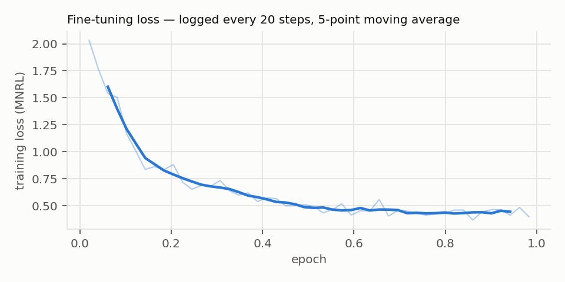
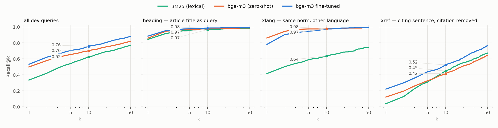
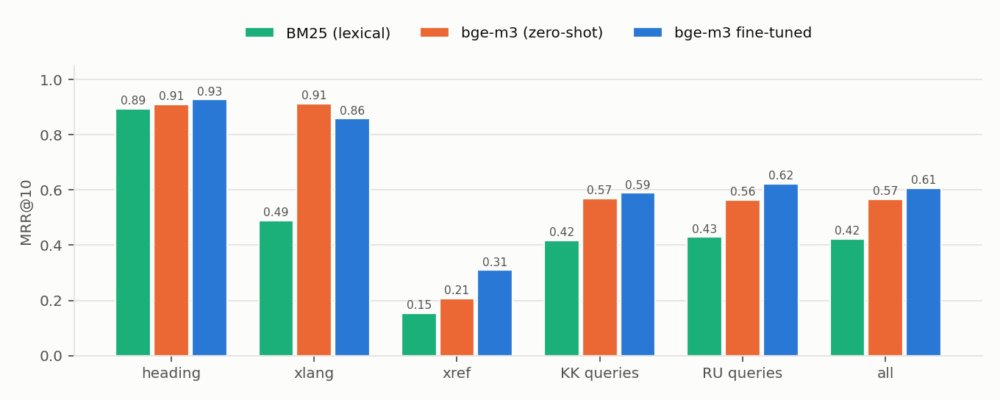

# LawRAG — midterm report: the baseline retriever

**Project:** LawRAG — offline, bilingual (RU/KK) question answering over the
Codes of the Republic of Kazakhstan · **Stage:** midterm (baseline) ·
**Author:** Yelarys · **Proposal:** [`docs/LawRAG_Project_Proposal.docx`](../LawRAG_Project_Proposal.docx)

Every number in this report is produced by one command and can be
regenerated (§ 9). The generated tables live in
[`reports/midterm/results.md`](../../reports/midterm/results.md) and the raw
values in [`reports/midterm/results.json`](../../reports/midterm/results.json).

| criterion | where |
| --- | --- |
| 1. Working code | § 9 (how to run), § 10 (code map); `pytest` passes |
| 2. Trained baseline model | § 3 (model, configuration, training parameters, loss curve) |
| 3. At least two metrics | § 4 |
| 4. Initial results | § 5 (tables, figures, interpretation, error analysis) |
| 5. Model selection rationale | § 6 |
| 6. Presentation | § 8 (slide deck) |
| 7. Research conclusion | § 7 |

---

## 1. Task / Задача

A LawRAG answer is only as good as the articles retrieved for it: the
generator may cite only what the retriever put in front of it, and the
citation verifier rejects everything else. The component that decides answer
quality, and the one that can be *trained*, is therefore the **dense
retriever** — the model that maps a question and every statutory text to
vectors so that the nearest texts answer the question.

Formally, the midterm task is **ranking**: given a query *q* in Russian or
Kazakh, rank all 43,857 chunks of the corpus so that a chunk of the correct
article comes as high as possible. The unit of correctness is the
**article** (any chunk of it, in the target language), because that is the
unit the answer packet is built from and the unit a citation names.

This report covers the dense branch alone — no lexical fusion, reranker or
relevance floor — so that the effect of the *model* is measured in isolation.

## 2. Data / Данные

**Corpus.** A dated snapshot of the official portal adilet.zan.kz
(2026-09-08): 41 documents — 21 codes (civil, tax, administrative
offences, labour, criminal, customs, land, …), each in Russian and Kazakh
except the Civil Procedure Code (Russian only) — parsed into 8,771 articles
and **43,857 chunks** (22,361 RU, 21,496 KK). The snapshot is in `data/adilet/` with its
`documents.json` manifest; the invented fixture used by the test suite lives
separately in `tests/fixtures/synthetic/` and never enters the experiment.

**Labels.** There is no labelled question set for Kazakhstani law, and no
lawyer on the team to write one. The corpus supervises itself
(`src/lawrag/train/pairs.py`) — each pair is (query, the chunk that answers
it):

| kind | query | positive | why it is a fair query |
| --- | --- | --- | --- |
| `heading` | an article's title | that article | the terse way people type a search |
| `xref` | a sentence that cites article B, **with the citation cut out** | article B | the closest proxy for a real question: the sentence describes what B regulates, and the number it could match on is gone |
| `xlang` | the Russian text of a provision | its Kazakh text (and back) | Kazakh questions must find Russian articles and vice versa |
| `definition` | a defined term, bare and as a question | the definition | glossary look-ups (train only — no definition article fell in dev) |

**Split — by article, not by pair.** 5% of articles are held out by a
seeded hash of the article id. Every pair whose answer is a held-out article
goes to **dev**; the rest is **train**. Dev therefore asks about articles the
model was never trained to retrieve. Three safeguards keep it clean:

* train and dev share **0** articles — `lawrag experiment` refuses to run
  otherwise;
* dev articles are also excluded from the **negatives** the trainer sees
  (`--hold-out-dev`, on by default): no dev text reaches training at all;
* the dev set is used only for the final measurement. The one baseline
  hyper-parameter that was tuned (BM25's stem length) was chosen on a sample
  of *train* pairs.

**Properties of the data that shaped the model choice** (measured with the
bge-m3 tokenizer on a 3,000-chunk sample):

| property | value | consequence |
| --- | --- | --- |
| two languages, legally equivalent, lexically unrelated | RU 51% / KK 49% of chunks | a lexical model cannot cross languages; a multilingual encoder can |
| Kazakh is agglutinative, Russian highly inflected | "штраф / штрафа / штрафом" | whole-word matching fails; subword models or stemming are needed |
| chunk length | median 213 (RU) / 234 (KK) tokens, p90 ≈ 475 / 539 | a 512-token encoder covers ~90% of chunks whole |
| query length | heading 13, xref 51, xlang 106 tokens (median) | queries are short against long documents: asymmetric retrieval |
| label volume | ~31k mined pairs, 7.2k train articles | enough to *adapt* a pre-trained model, far too few to train one from scratch |
| deployment | air-gapped workstation, 8 GB GPU | model must run locally; training must fit 8 GB |

## 3. Baseline model / Baseline-модель

### 3.1 What is trained

**bge-m3** (BAAI, 2024): an XLM-RoBERTa-large bi-encoder already trained for
multilingual retrieval. Query and chunk are encoded separately; the
embedding is the `[CLS]` vector, L2-normalised; relevance is the cosine
similarity. Because the encoder is shared and the corpus is encoded once,
retrieval over 43,857 chunks is one matrix product per query.

| architecture | value |
| --- | --- |
| encoder | XLM-RoBERTa-large: 24 layers, hidden 1024, 16 heads, FFN 4096 |
| vocabulary | 250,002 SentencePiece tokens (covers Cyrillic Kazakh letters ә, ғ, қ, ң, ө, ұ, ү, һ, і) |
| parameters | 568M |
| pooling / output | `[CLS]`, 1024-d, L2-normalised |
| similarity | cosine (dot product of unit vectors) |

The baseline **trained in this project** is bge-m3 fine-tuned on the train
pairs (`src/lawrag/train/finetune.py`):

* **Loss:** Multiple Negatives Ranking Loss (InfoNCE). For each (query,
  positive) the other 31 positives in the batch are negatives, plus one
  **hard negative** — the highest-ranked *wrong* article under the stock
  model, which is what teaches "article 277 vs article 278". The cached
  (GradCache) variant computes the loss over the full batch of 32 while only
  8 sequences are on the GPU at once.
* **Partial fine-tuning:** only the top 8 of 24 layers are updated. The lower
  layers hold the multilingual lexical knowledge the model came with;
  freezing them cuts optimiser memory by two thirds and guards against
  catastrophic forgetting on a corpus this small.
* **Gradient checkpointing** and fp16, to fit an 8 GB laptop GPU.

The complete training configuration and the loss curve are generated from
the saved model (`<model>/lawrag_train.json`) into
[`reports/midterm/results.md`](../../reports/midterm/results.md#training-configuration)
and reproduced in § 5.

### 3.2 Reference points it is compared with

| system | what it is | learned from the train pairs? |
| --- | --- | --- |
| **BM25** (`src/lawrag/train/lexical.py`) | Okapi BM25, k1 = 1.2, b = 0.75, tokens cut to a 6-character prefix (crude stemming for both languages) | no — corpus statistics only |
| **bge-m3 zero-shot** | the stock model, no adaptation | no |
| **bge-m3 fine-tuned** | § 3.1 | **yes** |

Both reference points are scored by the same harness on the same queries
and the same corpus, so differences are due to the model alone.

## 4. Metrics / Метрики

Each dev query has exactly one correct article, and the retriever's output is
a ranked list. Classification metrics (accuracy, F1) do not fit: there are
8,771 "classes", most dev articles were never seen in training, and what
matters is *where* the right article lands, not a yes/no decision. Two
ranking metrics are used:

**Recall@k** (k = 1, 5, 10) — the share of queries whose correct article is
among the top *k* results.

* *What it shows:* whether the evidence reaches the next stage at all. In
  LawRAG the top results go into the answer packet (and, in production,
  to the reranker), so an article outside the top *k* is lost for good —
  no later stage can recover it.
* *Why it fits:* it maps directly onto a system parameter (packet size /
  rerank depth). Recall@10 is the headline because roughly ten articles fit
  the packet's token budget; Recall@1 is reported as the strictest view.
* *Limitation:* it is blind to position inside the top *k* — rank 1 and
  rank 10 count the same.

**MRR@10** (Mean Reciprocal Rank, cut at 10) — the mean of 1/rank of the
correct article, counting 0 when it is below rank 10.

* *What it shows:* how *high* the right article is ranked. Rank 1 → 1.0,
  rank 2 → 0.5, rank 10 → 0.1.
* *Why it fits:* there is exactly one relevant article per query, which is
  exactly the case MRR is designed for (with one relevant item, nDCG adds
  nothing but a different discount). Position matters here: the generator
  weights earlier context more, and the top hit is what the console shows
  first.
* *Limitation:* it is dominated by ranks 1–3, so it says little about
  whether a missed article is "nearly there".

Reported with each metric: a **per-kind** and **per-language** breakdown
(RU vs KK was a stated goal of the proposal), **95% bootstrap confidence
intervals** over queries, and a **paired** comparison of the fine-tuned model
against each reference on the same queries.

## 5. Results / Результаты

All numbers: 1,620 dev queries over 366 held-out articles, ranked against
the full corpus of 43,857 chunks. Brackets are 95% bootstrap intervals. The
complete generated tables (by kind × language, error categories, examples)
are in [`reports/midterm/results.md`](../../reports/midterm/results.md).

### 5.1 Training



The contrastive loss falls from 2.0 to ≈ 0.45 by 70% of the epoch and then
plateaus. One epoch (977 steps, 78 min) is enough at this learning rate, and
the flat tail says more epochs on the same pairs would add little — the next
gains have to come from better pairs (§ 7).

### 5.2 Overall

| system | Recall@1 | Recall@10 | MRR@10 |
| --- | --- | --- | --- |
| BM25 (lexical) | 0.335 [0.312, 0.358] | 0.625 [0.601, 0.648] | 0.424 [0.402, 0.444] |
| bge-m3 zero-shot | 0.499 [0.475, 0.524] | 0.702 [0.679, 0.725] | 0.567 [0.545, 0.589] |
| **bge-m3 fine-tuned** | **0.533** [0.507, 0.557] | **0.757** [0.736, 0.777] | **0.607** [0.584, 0.628] |

Paired on the same queries, the fine-tuned model beats the zero-shot one by
**+0.040 MRR@10** [+0.022, +0.058] and **+0.055 Recall@10** [+0.034,
+0.077] — both intervals exclude zero — improving 377 queries and worsening
262. Against BM25: +0.183 MRR@10, +0.132 Recall@10.

A control: the same training *without* excluding dev articles from the
negatives (the project's earlier run) gave 0.540 / 0.755 / 0.610 — inside
the confidence intervals of the clean run. The leak was real in principle
but did not inflate the numbers.

### 5.3 By query kind and language





| slice (MRR@10) | n | BM25 | zero-shot | fine-tuned | note |
| --- | ---: | ---: | ---: | ---: | --- |
| `heading` | 392 | 0.894 | 0.910 | **0.927** | easy: the title is in the chunk text |
| `xlang` | 435 | 0.489 | **0.913** | 0.859 | the one regression |
| `xref` | 793 | 0.155 | 0.208 | **0.310** | +49% relative; Recall@1 0.12 → 0.22 |
| RU queries | 812 | 0.430 | 0.564 | **0.624** | |
| KK queries | 808 | 0.417 | 0.570 | **0.590** | the gain is smaller in Kazakh |

### 5.4 Interpretation

**What works.**

* **The realistic queries improved most.** On `xref` — a sentence that
  describes what an article regulates, with the article number removed —
  Recall@1 almost doubles (0.122 → 0.222) and Recall@10 rises from 0.42 to
  0.53. This is the query type closest to a user's question and the one the
  zero-shot model was worst at.
* **Dense beats lexical where it matters.** BM25 is competitive only on
  `heading` (the query is copied verbatim into the chunk) and, at k = 10, on
  `xref`; across languages it fails (MRR 0.49 vs 0.91), and what it does get
  there comes from shared article numbers, not meaning.
* **Titles are solved** by every system (Recall@10 ≥ 0.97): a sanity check,
  not a target.

**Where the model errs.** 757 of 1,620 queries miss rank 1; the median rank
of a miss is 12, so most misses are just past the cut-off rather than lost.

| top-1 of a miss | share |
| --- | ---: |
| same code, distant article | 46% |
| same code, article within ±5 | 18% |
| a different code | 18% |
| **the superseded Tax Code** (`nk` ↔ `nk2017`) | 17% |

* **Right code, wrong article** in 64% of misses: the topic is recognised,
  the exact provision is not — e.g. an obligation to pay customs duties
  retrieved as "obligations of a free-warehouse owner". Fine
  distinctions inside one code are what a cross-encoder reranker is for.
* **17% of misses are arguably not errors**: the corpus holds both the
  current Tax Code and the one it replaced, and the model returns the same
  norm from the old code. The production system's validity-date filter
  removes these; this offline evaluation does not apply it.
* **Shortcut learning on article numbers** — the most important finding:

  | `xref` MRR@10 | query names another article number (n = 279) | no number (n = 514) |
  | --- | ---: | ---: |
  | BM25 | 0.140 | 0.163 |
  | zero-shot | 0.172 | 0.228 |
  | fine-tuned | 0.164 | **0.389** |

  Fine-tuning helps digit-free queries enormously (+71%) and does nothing
  for queries that still contain *another* article's number; the share of
  misses whose top-1 is exactly the article the query names rose from 7% to
  12%. Chunk text begins "Статья 521 …", and the miner removes only the
  *target* citation from a sentence that cites several — so the model
  partly learned to match numbers instead of meaning.
* **Weak-supervision noise in the dev set itself.** 22% of Kazakh `xref`
  dev queries (18% in train) carry an orphaned case ending where the citation was cut
  ("Кодекстің **ына** сәйкес"): Recall@10 0.37 against 0.55 on clean
  queries. 1.6% of `xref` queries are amendment footnotes ("предусматривается
  исключить Законом РК от …") that no model can answer (0.00).
* **Cross-language matching regressed** at rank 1 (0.86 → 0.78), though not
  at rank 10 (0.977 → 0.975): `xlang` pairs were capped at 8,000 of ~40,000
  to keep citation sentences from being drowned out, and the monolingual
  pairs pulled the space toward same-language matching.

**Is it acceptable?** As a retrieval *stage*, yes, with caveats. Recall@10 =
0.76 means three in four questions put the right article into a 10-article
packet from the dense branch alone; in production that list is fused with
lexical and citation search and reranked, and the packet adds referenced
articles, so end-to-end recall is higher. For the hardest, most realistic
queries (`xref`, Recall@10 0.53) it is not good enough on its own — though
that 0.53 is itself depressed by label noise in the dev set. The gain over
the zero-shot model is statistically clear but modest overall (+0.04 MRR).

## 6. Why this model / Обоснование выбора модели

The choice follows from the data properties in § 2, not from popularity.

1. **Two languages that share no vocabulary.** The same norm in Russian and
   Kazakh has almost no tokens in common, and users ask in either language.
   Any lexical model (BM25, TF-IDF) can only match across languages through
   numbers and proper names. A *multilingual* encoder, which places
   translations near each other, is the only family that solves `xlang` by
   construction. bge-m3 was pre-trained for retrieval in 100+ languages,
   Kazakh included.
2. **Rich morphology.** Kazakh is agglutinative and Russian heavily
   inflected. bge-m3's SentencePiece vocabulary shares sub-word pieces between
   word forms, so no stemmer or dictionary has to be carried onto an
   air-gapped machine.
3. **Paraphrase, not keyword overlap.** A compliance officer's question and
   the statute describe the same obligation in different words. This is the
   case dense retrieval is built for; the `xref` queries (citation removed)
   test exactly that.
4. **Asymmetric, long documents.** Queries are 13–106 tokens, chunks a median
   of ~220 and up to 8k. bge-m3 was trained on query→passage retrieval with
   inputs up to 8,192 tokens; 512 covers ~90% of chunks.
5. **Few labels.** ~31k weakly-supervised pairs are enough to *adapt* a
   pre-trained retriever (contrastive fine-tuning of the top layers) but not
   to train one. Starting from a strong multilingual checkpoint is the only
   option that fits the label budget.
6. **Air gap and hardware.** The model must run locally (the proposal's
   confidentiality requirement) and train on an 8 GB GPU. bge-m3 is
   open-weight (MIT), 568M parameters (~1.1 GB in fp16), and its fine-tuning
   fits 8 GB with GradCache, checkpointing and frozen lower layers.
7. **One model, three retrieval modes.** bge-m3 also outputs sparse
   (lexical-weight) and multi-vector (ColBERT) representations, which the
   production system can use later without a second model.

**Alternatives considered and why they are not the baseline (yet):**

| alternative | why not now |
| --- | --- |
| **BM25 / TF-IDF** (no learning) | Kept as the reference point (§ 3.2). Cannot cross languages and cannot match paraphrases; already part of production as the lexical branch of hybrid search. |
| **Classifier over articles** (e.g. TF-IDF + logistic regression, or a fine-tuned BERT head with 8,771 classes) | Cannot predict an article it has not seen in training — and the dev set consists *only* of such articles, as will every newly enacted article. ~4 training examples per class; the label set changes with every amendment. |
| **Cross-encoder** (bge-reranker-v2-m3) | More accurate per pair, but scores (query, document) jointly: 43,857 forward passes per query. Belongs in a second stage over the top ~40 — which is how production uses it. Fine-tuning it is the next step, not the baseline. |
| **multilingual-e5-large / LaBSE / paraphrase-multilingual MiniLM** | Credible alternatives, not yet measured on this corpus. e5 is the same size; LaBSE is trained for translation pairs (`xlang`) rather than query→passage retrieval; MiniLM is faster but weaker on Kazakh. Worth a head-to-head (§ 7). |
| **Hosted embedding API** (e.g. gemini-embedding) | Strong, but sends legal questions off the machine — excluded by the confidentiality requirement. The harness can still evaluate it (`train-eval gemini`) as a commercial reference. |
| **Training an encoder from scratch** | 31k weak pairs are orders of magnitude short of what pre-training needs. |
| **Full fine-tuning of all 24 layers** | Triple the optimiser memory (does not fit 8 GB with this batch) and a higher risk of forgetting the multilingual alignment. Partial fine-tuning is the conservative baseline; unfreezing more layers is a next-stage ablation. |

## 7. Research conclusion / Исследовательский вывод

**What the first experiment showed.** Contrastive fine-tuning of bge-m3 on
pairs mined from the statutes themselves — no human labels — improves
retrieval of held-out articles over the same model zero-shot (MRR@10 0.567 →
0.607, Recall@10 0.70 → 0.76; paired 95% intervals exclude zero), and both
dense models clearly beat BM25 (MRR@10 0.424). The gain is concentrated
where it is needed — citation-style descriptions of a provision, Recall@1
0.12 → 0.22 — and the protocol is leak-free: dev articles are excluded from
positives and negatives, and the earlier leaky run scored the same.

**Limitations it revealed.**

1. **Shortcut learning:** the model learned to match article numbers; on
   queries that contain one, fine-tuning gained nothing.
2. **Noisy weak labels:** orphaned Kazakh case endings (18–22% of KK `xref`)
   and amendment footnotes mined as queries — in train and dev alike.
3. **Cross-language trade-off:** `xlang` Recall@1 fell 0.86 → 0.78 under the
   8,000-pair cap.
4. **Proxy queries:** every query is derived from statute text; none is a
   real user question, so the numbers measure how well the model reads the
   law, not how well it reads people.
5. **Partial pipeline:** dense branch only — no date filter (hence the
   `nk`/`nk2017` confusions), no reranker.

**Next experiment.**

1. **Fix the data, retrain, re-measure** — the cheapest and most
   informative step: mask *every* citation in an `xref` sentence, not only
   the target; cut the case ending together with the number; drop amendment
   footnotes; raise the `xlang` cap. Hypothesis: the with-number slice
   catches up with the digit-free one (MRR@10 ≈ 0.39) and `xlang` Recall@1
   returns to ≈ 0.86.
2. **Realistic queries:** generate natural questions per article
   (`train-pairs --doc2query`) and hand-label ~200 real compliance questions
   as a second, human test set.
3. **Second stage:** fine-tune the bge-reranker-v2-m3 cross-encoder on the
   same pairs and measure how much of Recall@10 it converts into Recall@1 —
   the remedy for the "right code, wrong article" misses (64%).
4. **Model comparison** on the same harness: multilingual-e5-large, and
   unfreezing more than 8 layers.

## 8. Presentation / Презентация

The 7-slide deck — task, data, baseline and why this model, metrics,
results, error analysis, conclusions and next stage — with speaker notes
on every slide: <https://claude.ai/artifact/XhX8Yka6EyVmEjNxSM5Amf>
(downloadable as PPTX or PDF). Its figures are the ones in
`reports/midterm/`.

## 9. How to reproduce / Как воспроизвести

Requirements: Python ≥ 3.11 and the `models` extra (or the Docker `models`
image), the bge-m3 weights, and for training an NVIDIA GPU with ≥ 8 GB.
No path is hard-coded: the weights directory is `--model-dir`, else
`$LAWRAG_MODEL_DIR`, else `$MODEL_DIR` (the name `download_models.py` and
`docker/.env` use), else `models/` in the repository.

```bash
pip install -e ".[models,dev]"
python scripts/download_models.py          # connected side: models/bge-m3 (+ reranker)
lawrag experiment                          # pairs -> fine-tune -> evaluate -> reports/midterm/
pytest                                     # the test suite (DB tests skip without Postgres)
```

`lawrag experiment` skips each stage whose output exists, so a second run only
re-evaluates. Stage by stage, with the same defaults:

```bash
lawrag train-pairs data/adilet                                   # -> data/train/{pairs.train,pairs.dev,corpus}.jsonl
lawrag train --base models/bge-m3 --out models/bge-m3-lawrag-midterm
lawrag train-eval bm25 models/bge-m3 models/bge-m3-lawrag-midterm
```

In Docker (from `docker/`, weights mounted at `/models`):

```bash
docker compose run --rm cli experiment --model-dir /models
```

Without a GPU the experiment still runs (`--no-train --device cpu` evaluates
the existing models, slowly); without any weights it evaluates BM25 only.
Running time on the reference machine (RTX 5070 Laptop, 8 GB): pair mining
~1 min, fine-tuning ~80 min, corpus encoding ~10 min per model (cached
afterwards), evaluation < 1 min.

## 10. Code map / Карта кода

| stage | file | what to look at |
| --- | --- | --- |
| parsing the corpus | `src/lawrag/ingest/parser.py`, `structure.py` | HTML → section / chapter / article / point tree, both languages |
| chunking | `src/lawrag/chunking/chunker.py` | the exact text unit that is embedded |
| pair mining & split | `src/lawrag/train/pairs.py` | `mine_*` functions, `split_pairs` (by article) |
| BM25 baseline | `src/lawrag/train/lexical.py` | `BM25.fit` / `BM25.score` |
| fine-tuning | `src/lawrag/train/finetune.py` | `mine_hard_negatives`, `_freeze_lower_layers`, `finetune` |
| evaluation | `src/lawrag/train/evaluate.py` | `ranks_from_scores`, `summarise`, `evaluate` |
| experiment & report | `src/lawrag/train/experiment.py` | `run_experiment`: the four stages; bootstrap; error analysis; figures |
| CLI | `src/lawrag/cli.py` | `train-pairs`, `train`, `train-eval`, `experiment` |
| tests | `tests/test_train.py` | mining, split, metric, BM25, statistics, end-to-end run on the fixture |
