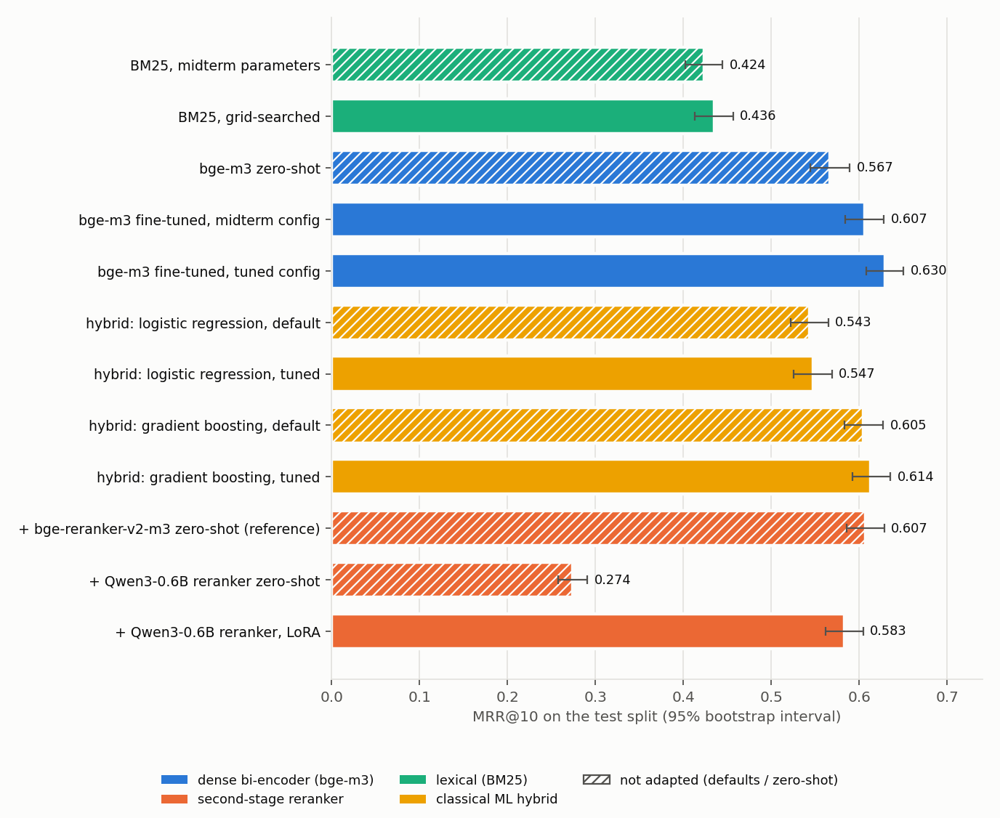
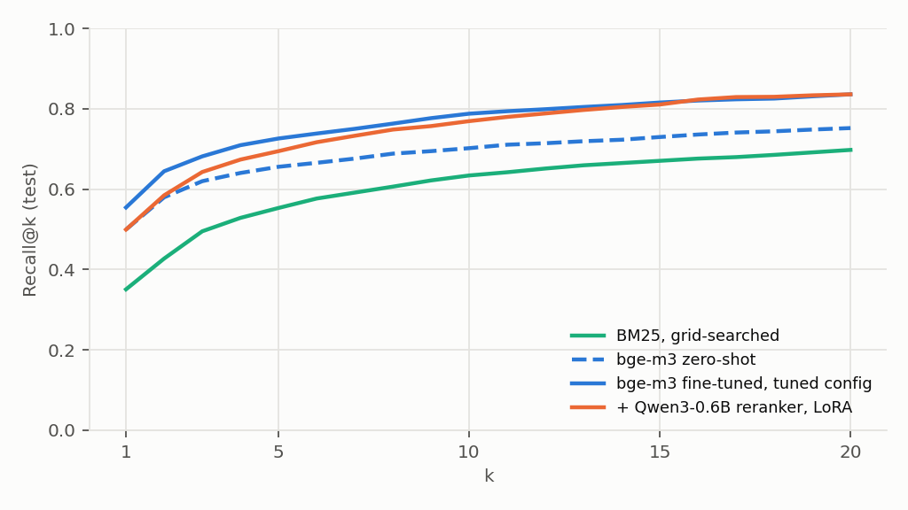
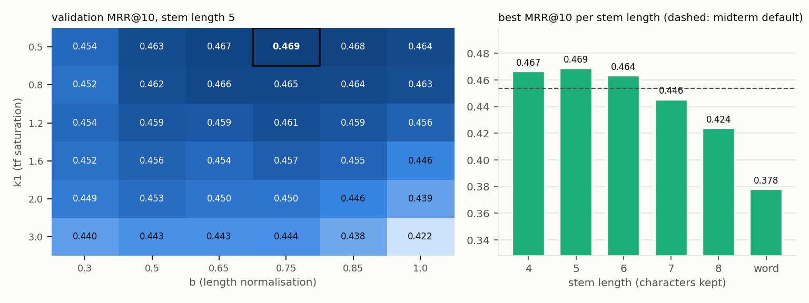
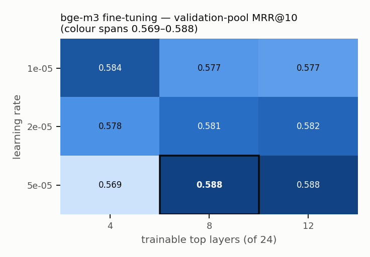
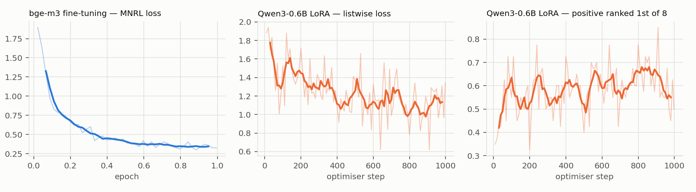

# Final experiment — generated results

_Generated by `lawrag final-experiment` on 2026-10-23 14:57. Do not edit by hand; re-run the command._

## 1. Data split (by article)

| split | used for | pairs | articles | heading | xref | xlang | definition |
| --- | --- | ---: | ---: | ---: | ---: | ---: | ---: |
| train | training every model | 28,925 | 6,876 | 7,237 | 12,178 | 7,170 | 2,340 |
| validation | every tuning / selection decision | 1,331 | 339 | 371 | 565 | 395 | 0 |
| test | final numbers only (touched once) | 1,620 | 366 | 392 | 793 | 435 | 0 |

Corpus: 43,857 chunks, ranked in full for every test query. Articles shared between any two splits: 0.

## 2. Unified results (test split)

Same 1 test split, same corpus, same metrics for every system; 95% bootstrap intervals over queries (2,000 resamples). Rerankers reorder the top 20 of the first stage (`dense-final`).

| # | system | family | learns from | tuning | Recall@1 | Recall@10 | MRR@10 |
| ---: | --- | --- | --- | --- | --- | --- | --- |
| 1 | BM25, midterm parameters | lexical | corpus statistics | — | 0.335 [0.312, 0.358] | 0.625 [0.601, 0.648] | 0.424 [0.402, 0.444] |
| 2 | BM25, grid-searched | lexical | corpus statistics | grid, 216 points (validation) | 0.351 [0.326, 0.375] | 0.634 [0.610, 0.657] | 0.436 [0.413, 0.457] |
| 3 | bge-m3 zero-shot | dense | nothing (transfer only) | — | 0.499 [0.475, 0.524] | 0.702 [0.679, 0.725] | 0.567 [0.545, 0.589] |
| 4 | bge-m3 fine-tuned, midterm config | dense | train pairs | — (lr 2e-5, top 8 layers) | 0.533 [0.507, 0.557] | 0.757 [0.736, 0.777] | 0.607 [0.584, 0.628] |
| 5 | **bge-m3 fine-tuned, tuned config** | dense | train pairs | grid, 9 points (validation) | 0.554 [0.530, 0.578] | 0.788 [0.768, 0.807] | **0.630 [0.608, 0.650]** |
| 6 | hybrid: logistic regression, default | hybrid | validation candidates | — | 0.457 [0.431, 0.481] | 0.752 [0.731, 0.773] | 0.543 [0.522, 0.565] |
| 7 | hybrid: logistic regression, tuned | hybrid | validation candidates | grid over C, 5-fold group CV | 0.464 [0.438, 0.488] | 0.754 [0.734, 0.775] | 0.547 [0.526, 0.569] |
| 8 | hybrid: gradient boosting, default | hybrid | validation candidates | — | 0.533 [0.508, 0.557] | 0.765 [0.744, 0.786] | 0.605 [0.584, 0.627] |
| 9 | hybrid: gradient boosting, tuned | hybrid | validation candidates | random search, 30 points, 5-fold group CV | 0.545 [0.520, 0.570] | 0.771 [0.751, 0.791] | 0.614 [0.592, 0.635] |
| 10 | + bge-reranker-v2-m3 zero-shot (reference) | reranker | nothing (transfer only) | — | 0.520 [0.495, 0.544] | 0.787 [0.767, 0.806] | 0.607 [0.586, 0.629] |
| 11 | + Qwen3-0.6B reranker zero-shot | reranker | nothing (transfer only) | — | 0.135 [0.119, 0.152] | 0.649 [0.626, 0.672] | 0.274 [0.258, 0.291] |
| 12 | + Qwen3-0.6B reranker, LoRA | reranker | train pairs (groups) | — | 0.499 [0.474, 0.523] | 0.769 [0.748, 0.790] | 0.583 [0.562, 0.605] |

### Each change, measured against what it changes

Paired on the same test queries; an interval that excludes 0 is a significant difference.

| change | system − baseline | Δ MRR@10 | Δ Recall@1 | Δ Recall@10 | better | worse |
| --- | --- | --- | --- | --- | ---: | ---: |
| BM25 parameter tuning | `bm25-tuned` − `bm25-default` | +0.012 [+0.005, +0.019] | +0.015 [+0.006, +0.025] | +0.009 [-0.003, +0.022] | 198 | 167 |
| transfer: pre-trained multilingual encoder vs tuned BM25 | `dense-zeroshot` − `bm25-tuned` | +0.132 [+0.113, +0.150] | +0.149 [+0.127, +0.171] | +0.068 [+0.047, +0.089] | 468 | 218 |
| fine-tuning (midterm configuration) | `dense-midterm` − `dense-zeroshot` | +0.040 [+0.022, +0.058] | +0.033 [+0.011, +0.056] | +0.055 [+0.034, +0.077] | 377 | 262 |
| fine-tuning hyper-parameter search | `dense-final` − `dense-midterm` | +0.023 [+0.012, +0.034] | +0.022 [+0.006, +0.037] | +0.031 [+0.017, +0.044] | 268 | 164 |
| gradient-boosting hyper-parameter search | `hybrid-hgb-tuned` − `hybrid-hgb-default` | +0.008 [+0.002, +0.015] | +0.012 [+0.002, +0.023] | +0.006 [-0.002, +0.014] | 166 | 138 |
| logistic-regression C search | `hybrid-logreg-tuned` − `hybrid-logreg-default` | +0.004 [-0.002, +0.010] | +0.007 [-0.003, +0.017] | +0.002 [-0.009, +0.012] | 203 | 196 |
| zero-shot LLM reranker vs its input | `rerank-qwen-zeroshot` − `dense-final` | -0.356 [-0.378, -0.335] | -0.419 [-0.446, -0.392] | -0.138 [-0.159, -0.119] | 153 | 975 |
| LoRA adaptation of the LLM reranker | `rerank-qwen-lora` − `rerank-qwen-zeroshot` | +0.309 [+0.290, +0.330] | +0.364 [+0.338, +0.391] | +0.120 [+0.099, +0.140] | 932 | 170 |
| LoRA LLM reranker vs its input | `rerank-qwen-lora` − `dense-final` | -0.047 [-0.063, -0.030] | -0.055 [-0.077, -0.033] | -0.019 [-0.033, -0.006] | 230 | 359 |
| LoRA Qwen3-0.6B vs bge-reranker-v2-m3 | `rerank-qwen-lora` − `rerank-bge` | -0.024 [-0.037, -0.011] | -0.020 [-0.040, -0.001] | -0.018 [-0.030, -0.006] | 224 | 309 |
| whole pipeline vs zero-shot bge-m3 | `dense-final` − `dense-zeroshot` | +0.063 [+0.045, +0.081] | +0.055 [+0.032, +0.078] | +0.086 [+0.064, +0.107] | 427 | 237 |

### By query kind and language (MRR@10)

| system | heading | xlang | xref | KK queries | RU queries |
| --- | ---: | ---: | ---: | ---: | ---: |
| BM25, midterm parameters | 0.894 | 0.489 | 0.155 | 0.417 | 0.430 |
| BM25, grid-searched | 0.890 | 0.551 | 0.147 | 0.433 | 0.438 |
| bge-m3 zero-shot | 0.910 | 0.913 | 0.208 | 0.570 | 0.564 |
| bge-m3 fine-tuned, midterm config | 0.927 | 0.859 | 0.310 | 0.590 | 0.624 |
| bge-m3 fine-tuned, tuned config | 0.930 | 0.902 | 0.333 | 0.611 | 0.649 |
| hybrid: logistic regression, default | 0.907 | 0.812 | 0.216 | 0.530 | 0.557 |
| hybrid: logistic regression, tuned | 0.912 | 0.802 | 0.227 | 0.532 | 0.563 |
| hybrid: gradient boosting, default | 0.915 | 0.917 | 0.281 | 0.587 | 0.623 |
| hybrid: gradient boosting, tuned | 0.919 | 0.927 | 0.290 | 0.593 | 0.634 |
| + bge-reranker-v2-m3 zero-shot (reference) | 0.938 | 0.880 | 0.294 | 0.589 | 0.625 |
| + Qwen3-0.6B reranker zero-shot | 0.409 | 0.358 | 0.161 | 0.229 | 0.319 |
| + Qwen3-0.6B reranker, LoRA | 0.937 | 0.849 | 0.263 | 0.568 | 0.599 |

## 3. Hyper-parameter tuning (validation split)

### 3.1 BM25 — exhaustive grid

Search space (216 points, `ParameterGrid`), scored on all 1,331 validation queries against the full corpus, selected by MRR@10 (ties: Recall@10):

| parameter | values |
| --- | --- |
| stem length (`prefix`, 0 = whole word) | [4, 5, 6, 7, 8, 0] |
| k1 (term-frequency saturation) | [0.5, 0.8, 1.2, 1.6, 2.0, 3.0] |
| b (length normalisation) | [0.3, 0.5, 0.65, 0.75, 0.85, 1.0] |

| configuration | prefix | k1 | b | val Recall@1 | val Recall@10 | val MRR@10 |
| --- | ---: | ---: | ---: | ---: | ---: | ---: |
| midterm default | 6 | 1.2 | 0.75 | 0.378 | 0.629 | 0.454 |
| **best** | 5 | 0.5 | 0.75 | 0.394 | 0.637 | 0.469 |

Best MRR@10 per stem length:

| prefix | best k1 | best b | val MRR@10 |
| ---: | ---: | ---: | ---: |
| 4 | 0.5 | 0.85 | 0.467 |
| 5 | 0.5 | 0.75 | 0.469 |
| 6 | 0.5 | 0.75 | 0.464 |
| 7 | 0.5 | 0.75 | 0.446 |
| 8 | 0.5 | 0.85 | 0.424 |
| whole word | 0.5 | 0.5 | 0.378 |

### 3.2 bge-m3 fine-tuning — exhaustive grid (low-fidelity trials)

Each trial fine-tunes stock bge-m3 on the same 4,000 training pairs and is scored on a fixed validation pool of 32,940 chunks (every chunk of the validation articles + the top 30 per validation query under stock bge-m3 and BM25 + 5,000 random chunks). Everything else as in § 4.

| learning rate \ trainable top layers | 4 | 8 | 12 |
| --- | ---: | ---: | ---: |
| 1e-05 | 0.584 | 0.577 | 0.577 |
| 2e-05 | 0.578 | 0.581 | 0.582 |
| 5e-05 | 0.569 | **0.588** | 0.588 |

Cells: validation-pool MRR@10. Selected: learning rate **5e-05**, top **8** layers (Recall@10 0.721).

Reference points on the same pool: stock bge-m3 (zero-shot) MRR@10 0.580; the midterm model 0.654 — **not comparable**: it was trained on all of the midterm's train articles, which include this validation split, so it has seen these answers. It is shown as a leak check only; on the untouched test split it is row 4 of § 2.

### 3.3 Learned hybrid — randomized search and grid search

Candidates: union of the top 30 of BM25 (tuned) and bge-m3 (fine-tuned) — 75,339 validation rows, 3.6% positive; the right article is among the candidates for 90.4% of validation and 92.4% of test queries. Model selection by 5-fold GroupKFold (grouped by article) on MRR@10.

| model | search | space | default CV MRR@10 | best CV MRR@10 | best parameters |
| --- | --- | --- | ---: | ---: | --- |
| logistic regression | grid (6 points) | C ∈ [0.001, 0.01, 0.1, 1.0, 10.0, 100.0] | 0.574 | 0.580 | C=0.001 |
| gradient boosting | randomized (30 points) | learning_rate ∈ ['loguniform', 0.02, 0.3]; max_leaf_nodes ∈ [7, 15, 31, 63]; max_depth ∈ [None, 3, 5, 8]; min_samples_leaf ∈ [10, 20, 50, 100]; l2_regularization ∈ ['loguniform', 0.001, 10.0]; max_iter ∈ [100, 200, 400] | 0.612 | 0.616 | learning_rate=0.0531, max_leaf_nodes=31, max_depth=8, min_samples_leaf=50, l2_regularization=0.00211, max_iter=400 |

## 4. Classical ML: before and after tuning (test split)

| model | before tuning: Recall@1 / Recall@10 / MRR@10 | after tuning | Δ MRR@10 |
| --- | --- | --- | --- |
| BM25 | 0.335 / 0.625 / 0.424 | 0.351 / 0.634 / 0.436 | +0.012 [+0.005, +0.019] |
| hybrid: logistic regression | 0.457 / 0.752 / 0.543 | 0.464 / 0.754 / 0.547 | +0.004 [-0.002, +0.010] |
| hybrid: gradient boosting | 0.533 / 0.765 / 0.605 | 0.545 / 0.771 / 0.614 | +0.008 [+0.002, +0.015] |

Permutation importance of the hybrid's features (drop in validation average precision; tuned models) and the logistic-regression coefficients (standardised features):

| feature | gradient boosting | logistic regression | LR coefficient |
| --- | ---: | ---: | ---: |
| `dense_score` | 0.0929 | 0.0050 | +0.117 |
| `dense_margin` | 0.1891 | 0.0087 | +0.157 |
| `dense_log_rank` | 0.1808 | 0.0024 | -0.075 |
| `bm25_norm` | 0.2302 | 0.0383 | +0.303 |
| `bm25_margin` | 0.0000 | 0.0383 | +0.303 |
| `bm25_log_rank` | 0.1944 | 0.0443 | -0.370 |
| `rrf` | 0.0798 | 0.0678 | +0.302 |
| `in_both_top` | 0.0000 | -0.0012 | +0.069 |
| `names_this_article` | 0.0132 | 0.0006 | +0.014 |
| `same_code_as_dense_top1` | 0.1139 | 0.0656 | +0.411 |
| `query_has_number` | 0.0434 | 0.0011 | +0.077 |
| `chunk_log_chars` | 0.1864 | 0.0060 | -0.180 |

## 5. Fine-tuning configuration — bge-m3 bi-encoder (`dense-final`)

| parameter | value |
| --- | --- |
| base model | bge-m3 (XLM-RoBERTa-large, 568M) |
| training pairs | 28,925 (train split) |
| epochs | 1.0 |
| batch size (in-batch negatives) | 32 |
| mini-batch (GradCache) | 8 |
| optimizer | adamw_torch (AdamW), weight decay 0.0 |
| learning rate | 5e-05 (selected by § 3.2) |
| schedule | linear, 10% linear warm-up |
| loss | CachedMultipleNegativesRankingLoss (scale 20, cosine similarity) |
| negatives | 31 in-batch + 1 hard negative per pair (top-20 wrong article under the base model) |
| max sequence length | 512 |
| trainable layers | top 8 of 24 (selected by § 3.2) |
| trainable / frozen parameters | 100.8M / 467.0M |
| precision | fp16 mixed precision, gradient checkpointing |
| held-out articles (never positive nor negative) | 705 |
| seed | 13 |
| training time | 72 min |

## 6. LoRA configuration — Qwen3-0.6B reranker (`rerank-qwen-lora`)

| parameter | value |
| --- | --- |
| base model | Qwen3-0.6B (decoder LLM, 28 layers, frozen) |
| quantisation | none: frozen base in bf16, adapters in fp32 (4-bit QLoRA crashed the GPU driver on this machine; see llm_rerank.py) |
| LoRA rank r | 16 |
| LoRA alpha | 32 (scale alpha/r = 2) |
| LoRA dropout | 0.05 |
| target modules | `q_proj`, `k_proj`, `v_proj`, `o_proj`, `gate_proj`, `up_proj`, `down_proj` |
| trainable parameters | 10,092,544 of 606,142,464 (1.67%) |
| optimizer | AdamW, weight decay 0.0, grad-norm clip 1.0 |
| learning rate | 0.0001, cosine schedule, 5% warm-up |
| epochs | 1 |
| batch | 4 groups x 8 documents = 32 sequences per optimiser step |
| training data | 3,994 groups (1 positive + 7 negatives: 4 hardest + 3 sampled from the fine-tuned bi-encoder's top 30) |
| loss | listwise softmax cross-entropy over the group's yes/no log-odds |
| score | logit("yes") − logit("no") at the answer slot |
| max length | 512 tokens (query ≤ 128) |
| optimiser steps | 998 |
| peak VRAM | 4.72 GB |
| seed | 13 |
| training time | 70 min |

## 7. Shortcut check — leftover article numbers in `xref` queries

| system | MRR@10, query names another article | MRR@10, no number | misses lured to the named article |
| --- | --- | --- | ---: |
| bge-m3 zero-shot | 0.172 (n=279) | 0.228 (n=514) | 7% |
| bge-m3 fine-tuned, midterm config | 0.164 (n=279) | 0.389 (n=514) | 12% |
| bge-m3 fine-tuned, tuned config | 0.205 (n=279) | 0.402 (n=514) | 11% |

## Error analysis — bge-m3 fine-tuned, tuned config

722 of 1620 test queries miss rank 1 (median rank of a miss: 10).

| where the top-1 landed | queries | share |
| --- | ---: | ---: |
| same code, distant article | 330 | 46% |
| same code, article within ±5 | 144 | 20% |
| different code | 135 | 19% |
| superseded Tax Code (nk ↔ nk2017) | 113 | 16% |

## Reproducibility

* seed **13** everywhere (pair shuffling, hard-negative sampling, trainer, bootstrap, hybrid CV and search); validation hash seed 29; test split unchanged from the midterm (hash seed 13);
* git commit `7739169` (with uncommitted changes);
* Python 3.12.9 on Windows-11-10.0.26200-SP0; GPU NVIDIA GeForce RTX 5070 Laptop GPU (8.0 GB, CUDA 13.0);

| library | version |
| --- | --- |
| torch | 2.14.0+cu130 |
| transformers | 5.12.1 |
| sentence-transformers | 6.0.1 |
| peft | 0.19.1 |
| bitsandbytes | 0.50.2 |
| accelerate | 1.14.0 |
| datasets | 5.0.1 |
| scikit-learn | 1.9.1 |
| numpy | 2.5.3 |
| scipy | 1.18.1 |
| matplotlib | 3.10.9 |

## Figures

