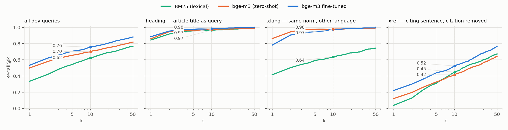
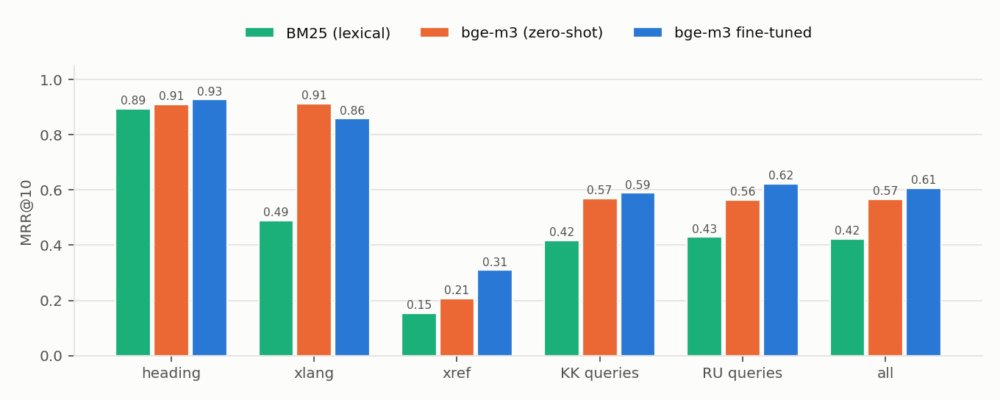
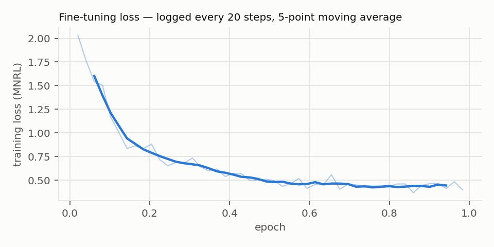

# Baseline experiment — generated results

_Generated by `lawrag experiment` on 2026-10-09 18:29. Do not edit by hand; re-run the command._

## Data

| split | pairs | articles | heading | xref | xlang | definition |
| --- | ---: | ---: | ---: | ---: | ---: | ---: |
| train | 31,246 | 7,215 | 7,608 | 12,743 | 7,565 | 3,330 |
| dev | 1,620 | 366 | 392 | 793 | 435 | 0 |

Corpus: 43,857 chunks. Train and dev share 0 articles.

## Training configuration

| parameter | value |
| --- | --- |
| base model | bge-m3 |
| training pairs | 31,246 |
| epochs | 1.0 |
| batch size (in-batch negatives) | 32 |
| mini-batch (GradCache) | 8 |
| learning rate | 2e-05 |
| warm-up | 10% linear |
| max sequence length | 512 |
| trainable layers (top) | 8 |
| trainable / frozen parameters | 100.8M / 467.0M |
| hard negatives | 1 per pair, top-20 under base model |
| dev articles held out of negatives | 366 |
| seed | 13 |
| training time | 78 min |

## Overall results (dev, all queries)

95% bootstrap confidence intervals over queries (2,000 resamples).

| system | Recall@1 | Recall@10 | MRR@10 |
| --- | --- | --- | --- |
| BM25 (lexical) | 0.335 [0.312, 0.358] | 0.625 [0.601, 0.648] | 0.424 [0.402, 0.444] |
| bge-m3 (zero-shot) | 0.499 [0.475, 0.524] | 0.702 [0.679, 0.725] | 0.567 [0.545, 0.589] |
| bge-m3 fine-tuned | 0.533 [0.507, 0.557] | 0.757 [0.736, 0.777] | 0.607 [0.584, 0.628] |

Paired differences (fine-tuned minus other system, same queries):

| comparison | Δ MRR@10 | Δ Recall@10 | queries better | queries worse |
| --- | --- | --- | ---: | ---: |
| fine-tuned vs BM25 (lexical) | +0.183 [+0.163, +0.204] | +0.132 [+0.106, +0.157] | 609 | 250 |
| fine-tuned vs bge-m3 (zero-shot) | +0.040 [+0.022, +0.058] | +0.055 [+0.034, +0.077] | 377 | 262 |

## By query kind and language

| system | slice | n | Recall@1 | Recall@5 | Recall@10 | MRR@10 |
| --- | --- | ---: | ---: | ---: | ---: | ---: |
| BM25 (lexical) | heading | 392 | 0.844 | 0.954 | 0.967 | 0.894 |
| BM25 (lexical) | xlang | 435 | 0.416 | 0.591 | 0.637 | 0.489 |
| BM25 (lexical) | xref | 793 | 0.039 | 0.310 | 0.449 | 0.155 |
| BM25 (lexical) | kk | 808 | 0.329 | 0.538 | 0.619 | 0.417 |
| BM25 (lexical) | ru | 812 | 0.341 | 0.544 | 0.631 | 0.430 |
| bge-m3 (zero-shot) | heading | 392 | 0.860 | 0.967 | 0.974 | 0.910 |
| bge-m3 (zero-shot) | xlang | 435 | 0.862 | 0.975 | 0.977 | 0.913 |
| bge-m3 (zero-shot) | xref | 793 | 0.122 | 0.327 | 0.416 | 0.208 |
| bge-m3 (zero-shot) | kk | 808 | 0.498 | 0.666 | 0.707 | 0.570 |
| bge-m3 (zero-shot) | ru | 812 | 0.501 | 0.645 | 0.697 | 0.564 |
| bge-m3 fine-tuned | heading | 392 | 0.885 | 0.977 | 0.985 | 0.927 |
| bge-m3 fine-tuned | xlang | 435 | 0.782 | 0.947 | 0.975 | 0.859 |
| bge-m3 fine-tuned | xref | 793 | 0.222 | 0.439 | 0.525 | 0.310 |
| bge-m3 fine-tuned | kk | 808 | 0.517 | 0.679 | 0.738 | 0.590 |
| bge-m3 fine-tuned | ru | 812 | 0.548 | 0.732 | 0.776 | 0.624 |

## Shortcut check — leftover article numbers in `xref` queries

| system | MRR@10, query names another article number | MRR@10, no number | misses whose top-1 is the article the query names |
| --- | --- | --- | ---: |
| BM25 (lexical) | 0.140 (n=279) | 0.163 (n=514) | 2% |
| bge-m3 (zero-shot) | 0.172 (n=279) | 0.228 (n=514) | 7% |
| bge-m3 fine-tuned | 0.164 (n=279) | 0.389 (n=514) | 12% |

## Error analysis — fine-tuned model

757 of 1620 dev queries do not have the right article at rank 1 (median rank of those: 12). Where the wrong top-1 hit came from:

| where the top-1 landed | queries | share of misses |
| --- | ---: | ---: |
| same code, distant article | 352 | 46% |
| same code, article within ±5 | 138 | 18% |
| different code | 136 | 18% |
| superseded Tax Code (nk ↔ nk2017) | 131 | 17% |

By query kind:

| kind | same code, distant article | same code, article within ±5 | different code | superseded Tax Code (nk ↔ nk2017) |
| --- | ---: | ---: | ---: | ---: |
| heading | 9 | 2 | 10 | 24 |
| xlang | 34 | 17 | 14 | 30 |
| xref | 309 | 119 | 112 | 77 |

`xref` queries by data quality (mining artefacts found during this analysis):

| xref query | n | Recall@10 | MRR@10 |
| --- | ---: | ---: | ---: |
| clean | 691 | 0.554 | 0.328 |
| kk orphan suffix | 89 | 0.371 | 0.218 |
| amendment footnote | 13 | 0.000 | 0.000 |

Random `xref` queries the fine-tuned model misses (right article not in the top 10):

1. **[ru]** предусматривается исключить Законом РК от 11.06.2026 № 306-VIII (вводится в действие с 01.01.2027).
   - expected: `sk/st89 — Статья 89. Приостановление, возобновление и прекращение бюджетных субсидий` (rank 106)
   - top-1: `sk/st234 — Статья 234. Право на государственное социальное пособие по случаю потери кормильца и условия его назначения` — *same code, distant article*

2. **[kk]** Осы Кодекстің немесе 416-бабында көзделген нысанда тауарлар шығарылғаннан кейін кедендік бақылауды жүргізу нәтижелері бойынша кеден органы осы бапқа сәйкес кедендік баждарды, салықтарды, арнайы, демпингке қарсы, өтема…
   - expected: `tamk/st411 — 411-бап. Кедендік, өзге құжаттарды және (немесе) мәліметтерді тауарлар шығарылғаннан кейін басталған және өзге жағдайларда тексеру` (rank 33)
   - top-1: `tamk/st407 — 407-бап. Кедендік бақылау нысандары` — *same code, article within ±5*

3. **[ru]** Корректировка суммы налога на добавленную стоимость, относимого в зачет, в случае, установленном подпунктом 6) пункта 2 настоящей статьи, производится в налоговом периоде, определенном настоящего Кодекса.
   - expected: `nk/st481 — Статья 481. Дата отнесения в зачет налога на добавленную стоимость` (rank 14)
   - top-1: `nk2017/st423 — Статья 423. Налоговый период` — *superseded Tax Code (nk ↔ nk2017)*

4. **[kk]** 3) еркін кеден аймағы кедендік рәсімінің қолданылуы тоқтатылған тауарларды және (немесе) қолданылуы тоқтатылған осындай кедендік рәсімді қолдану шеңберінде еркін кеден аймағы кедендік рәсімімен орналастырылған тауарла…
   - expected: `tamk/st209 — 209-бап. Кедендік рәсімнің қолданысын аяқтау, тоқтату, тоқтата тұру және қайта бастау` (rank 45)
   - top-1: `tamk/st292 — 292-бап. Еркін қойма кедендік рәсімінің мазмұны және қолданылуы` — *same code, distant article*

5. **[kk]** Бұл ретте өндіру учаскесін (учаскелерін) бекіту мақсатында келісімшартқа толықтыруда осы Кодекстің сәйкес өндіру учаскесін (учаскелерін) белгілейтін келісімшартқа қосымша қамтылуға тиіс;
   - expected: `nedra/st110 — 110-бап. Көмірсутектер бойынша жер қойнауын пайдалану жөніндегі операцияларды жүргізу үшін берілетін жер қойнауы учаскелері` (rank 20)
   - top-1: `zk/st112 — 112-бап. Өнеркәсіп жері` — *different code*

6. **[ru]** Дознание по делам об уголовных правонарушениях, предусмотренных (частью первой) Уголовного кодекса Республики Казахстан, производится начавшими досудебное расследование органами внутренних дел или национальной безопас…
   - expected: `uk/st394 — Статья 394. Организация незаконной миграции` (rank 296)
   - top-1: `uk/st35 — Статья 35. Осуществление оперативно-розыскных, контрразведывательных мероприятий или негласных следственных действий` — *same code, distant article*

7. **[kk]** 3) осы Кодекстің 521-бабы 1-тармағының 7) тармақшасында көзделген міндет осы Кодекстің 86-бабының 4-тармағына және ына сәйкес кеден органы жіберген хабарламада көрсетілген мерзімде орындалмаған не тиісінше орындалмаға…
   - expected: `tamk/st137 — 137-бап. Арнайы, демпингке қарсы, өтемақы баждарын төлеу жөніндегі міндетті орындау` (rank 60)
   - top-1: `tamk/st521 — 521-бап. Еркін қойма иесінің міндеттері` — *same code, distant article*

8. **[kk]** Осы баптың 1-тармағында көрсетілген құжаттарды тұлғалар және кеден органдары, олардың кедендік декларацияны беру кезінде ұсынылғанына немесе ұсынылмағанына қарамастан, осы Кодекстің 7, 8, 9, 10, 11, 12, 13, 14 және 15…
   - expected: `tamk/st34 — 34-бап. Тауарлардың кедендік бақылауда болуы` (rank 176)
   - top-1: `tamk/st89 — 89-бап. Кедендік баждар, кедендік алымдар, салықтар, өсімпұлдар, пайыздар бойынша талап қоюдың ескіру мерзімі` — *same code, distant article*

## Figures

